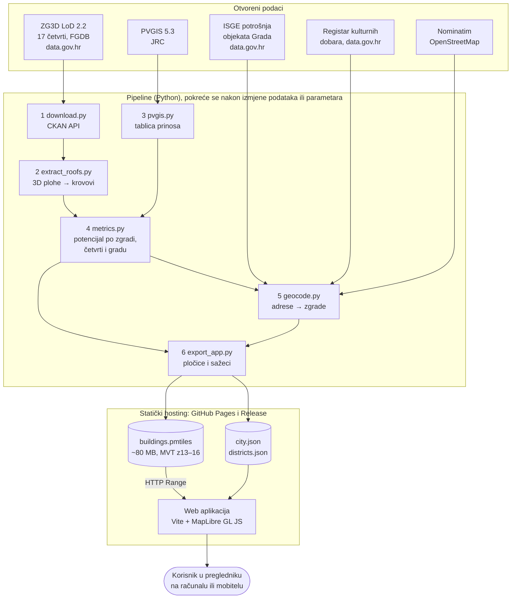
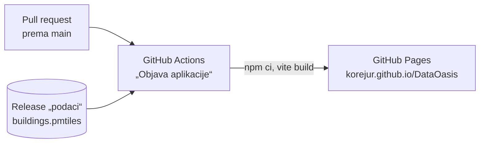

# Tehnička arhitektura

Krov+ ima dva dijela: **pipeline za obradu podataka** (Python), koji sve izračune radi unaprijed, i
**statičku web aplikaciju** (JavaScript), koja rezultate prikazuje na karti. Nema poslužitelja s
bazom ni API-ja koji bi trebalo održavati: aplikacija je skup datoteka na statičkom hostingu.

* Aplikacija: https://korejur.github.io/DataOasis/
* Izvorni kod: https://github.com/korejur/DataOasis (MIT)
* Skupovi podataka: [`PODACI.md`](PODACI.md) · formule i parametri: [`METODOLOGIJA.md`](METODOLOGIJA.md)

## 1. Pregled

Pretraga adrese u aplikaciji šalje upit izravno Nominatimu; ostalo se čita iz objavljenih datoteka.

**Zašto ovako:** svi izračuni (356 984 zgrade, ~1,2 GB ulaznih podataka) traju nekoliko minuta i
mijenjaju se samo kad se promijene ulazni podaci ili parametri. Zato se rade unaprijed, a aplikacija
samo čita gotove rezultate. Posljedice su besplatan hosting, nema poslužitelja koji može pasti ni
podataka o korisnicima, a karta se učitava brzo jer preglednik dohvaća samo pločice za vidljivi dio grada.

## 2. Pipeline za obradu podataka (`pipeline/`)

| Korak | Modul | Ulaz → izlaz | Napomena |
|---|---|---|---|
| 1 | `download.py` | CKAN API data.gov.hr → `data/raw/zg3d/` (FGDB, ~1,2 GB) | poveznice se svaki put čitaju iz CKAN-a, pa skripta radi i kad izdavatelj promijeni datoteke; nečitljiv FGDB automatski se zamjenjuje SHP verzijom |
| 2 | `extract_roofs.py` | 3D plohe → `data/processed/faces/`, `buildings/` (GeoParquet) | vlastiti parser WKB geometrije (TIN + poligon); normala po Newellovoj metodi; nagib, azimut, stvarna površina; četvrti se obrađuju paralelno |
| 3 | `pvgis.py` | PVGIS API → `data/reference/pvgis_zagreb.json` | ~300 upita: prinos kWh/kWp za mrežu nagiba i orijentacija |
| 4 | `metrics.py` | plohe + prinos → `buildings_metrics.parquet`, `district_summary.csv`, `city_summary.json` | zeleni krov (prikladnost, kišnica, trošak) i FN (snaga, proizvodnja, CO₂, povrat); uklanjanje duplikata na granicama četvrti; ~30 s |
| 5 | `geocode.py` | Registar kulturnih dobara, ISGE, Nominatim → `heritage_buildings.parquet`, `isge_buildings.parquet` | čišćenje adresa, geokodiranje (1 upit/s, predmemorija u gitu), spajanje točke s tlocrtom zgrade |
| 6 | `export_app.py` | sve gore → `app/public/data/` | vektorske pločice (GDAL, PMTiles) i JSON sažeci za grad, četvrti i objekte Grada; ~6 min |

* **Svi parametri** izračuna nalaze se na jednom mjestu, u `pipeline/config.py` (`PARAMS`), s izvorom
  za svaki u `METODOLOGIJA.md`. Promjena parametra znači ponovno pokretanje koraka 4 i 6. Geometrija se
  ne obrađuje ponovno.
* **Ključ zgrade** je `bldg_id` (npr. `trnje:1234`). Svaka tablica vezana uz zgradu ima taj stupac, pa se
  novi izvori (npr. javne ustanove, toplinski otoci) spajaju u izvoz bez izmjene ostatka pipelinea.
* **Koordinatni sustav** za sve izračune površina je HTRS96/TM (EPSG:3765, metri). Za web se podaci
  pretvaraju u Web Mercator (EPSG:3857) i WGS84 (EPSG:4326).

## 3. Web aplikacija (`app/`)

| Datoteka | Uloga |
|---|---|
| `src/main.js` | karta (MapLibre GL JS), slojevi zgrada, odabir zgrade i četvrti, 3D prikaz, legenda |
| `src/panel.js` | brojke za grad i četvrt, scenarij 10 / 30 / 100 %, prikaz „sve zgrade / samo objekti Grada“, rang-lista četvrti |
| `src/card.js` | kartica zgrade: krov, zeleni krov, FN, oznake kulturnog dobra i objekta Grada s potrošnjom |
| `src/search.js` | pretraga četvrti (lokalno, bez dijakritika) i adresa (Nominatim) |
| `src/onboarding.js` | uvod pri prvom posjetu u lijevom panelu |
| `src/layers.js`, `src/format.js` | boje i razredi, oblikovanje brojeva na hrvatskom |

* **Podaci za kartu:** `buildings.pmtiles` je jedna datoteka s vektorskim pločicama (MVT) za zume 13–16.
  Preglednik iz nje preko **HTTP Range** zahtjeva čita samo pločice koje su mu potrebne (u središtu grada
  ~2,4 MB po pogledu), pa ne treba poslužitelj pločica. Ispod zuma 13 prikazuju se četvrti iz `districts.json`.
* **Podloga karte:** OpenFreeMap (stil Positron, OSM), bez API ključa. OSM zgrade su skrivene, a
  prikazuju se zgrade iz ZG3D-a.
* **Prikaz na mobitelu:** panel i kartica postaju donji listovi, legenda se smanjuje.
* **Build:** Vite, statičke datoteke u `app/dist/`.

### Objava

`buildings.pmtiles` (~80 MB) nije u gitu, nego je prilog GitHub Releasea `podaci`. Workflow
`.github/workflows/pages.yml` ga pri svakoj objavi preuzima, gradi aplikaciju i objavljuje je na
GitHub Pages. Nakon novog izvoza datoteka se zamijeni naredbom
`gh release upload podaci app/public/data/buildings.pmtiles --clobber`.

## 4. Standardi i formati

| Standard / format | Gdje se koristi |
|---|---|
| **CKAN Action API** (v3) | automatsko preuzimanje ZG3D-a i čitanje metapodataka s data.gov.hr |
| **LoD 2.2** (razina detalja prema OGC CityGML) | ZG3D: krovovi kao zasebne ravne plohe |
| **Esri File Geodatabase (multipatch)**, Shapefile | izvorni format ZG3D-a |
| **HTRS96/TM (EPSG:3765)** | službena projekcija RH; svi izračuni površina i udaljenosti |
| **WGS84 (EPSG:4326)**, **Web Mercator (EPSG:3857)** | web karta, geokodiranje |
| **OGC GeoParquet** (Apache Parquet) | međurezultati pipelinea (`data/processed/`) |
| **Mapbox Vector Tiles (MVT)** u **PMTiles v3** | pločice zgrada za web |
| **JSON**, **GeoJSON** | sažeci po gradu i četvrtima, sloj četvrti na karti |
| **HTTP Range** (RFC 9110) | čitanje pločica iz jedne datoteke bez poslužitelja pločica |
| **REST API** PVGIS (JRC), Nominatim (OSM) | prinos FN, geokodiranje |

Svi izlazi su u otvorenim formatima i mogu se izravno učitati u QGIS, GeoPandas ili bilo koji
MapLibre/OpenLayers preglednik.

## 5. Integracija s javnim sustavima

* **Portal otvorenih podataka (data.gov.hr):** ZG3D se preuzima izravno preko CKAN API-ja. Kad Grad
  objavi novu verziju modela, pipeline se ponovno pokreće bez izmjena koda. Isti pristup radi za svaki
  grad koji objavi LoD 2 model u istom obliku.
* **Geoportal Grada Zagreba:** izlazne tablice imaju `bldg_id` i geometriju u EPSG:3765, pa se mogu
  objaviti kao sloj na Geoportalu (WMS/WFS preko GeoServera ili QGIS Servera) ili kao novi skup na data.gov.hr.
* **ISGE (Informacijski sustav za gospodarenje energijom):** potrošnja objekata Grada već se spaja sa
  zgradama. Redovito osvježavanje ISGE izvoza daje ažuran udio potrošnje koji FN može pokriti.
* **Registar kulturnih dobara:** zaštićene zgrade su označene. Uz koordinate u registru geokodiranje
  ne bi bilo potrebno.
* **Fond za zaštitu okoliša i energetsku učinkovitost (FZOEU) i gradski programi sufinanciranja:**
  rang-lista zgrada i četvrti može poslužiti kao podloga za javne pozive (npr. prvo javne zgrade s
  velikom potrošnjom i ravnim krovom).
* **Solarna karta Grada Zagreba:** Krov+ ne zamjenjuje izračun za pojedinu zgradu, nego daje gradski
  pregled i dodaje zelene krovove; obje karte mogu se međusobno povezati preko adrese.

## 6. Preduvjeti

### Tehnički

* **Za korištenje:** suvremeni preglednik (Chrome, Firefox, Safari, Edge) na računalu ili mobitelu.
  Nije potrebna instalacija ni prijava.
* **Za hosting:** bilo koji statički hosting koji podržava HTTP Range (GitHub Pages, gradski web
  poslužitelj, S3 i slično). ~85 MB prostora.
* **Za ponovni izračun:** Python 3.11+ s paketima iz `requirements.txt` (GDAL preko pyogrio),
  ~3 GB prostora na disku, pristup internetu za data.gov.hr, PVGIS i Nominatim. Za build aplikacije
  Node.js 20.19+. Upute su u README-u.

### Organizacijski

* **Vlasnik podataka:** pipeline koristi samo objavljene skupove, pa ne treba pristup internim sustavima
  Grada. Za redovitu upotrebu potrebno je da gradski ured (npr. za prostorno uređenje ili energetiku)
  preuzme ponovno pokretanje nakon nove verzije ZG3D-a ili ISGE izvoza.
* **Parametri:** cijene, potrošnja kućanstva i emisije mijenjaju se svake godine. Mijenjaju se na jednom
  mjestu (`pipeline/config.py`), uz izvor u `METODOLOGIJA.md`.
* **Tumačenje rezultata:** brojke su tehnički potencijal. Prije izvedbe potrebni su statička provjera
  krova, suglasnost konzervatora za kulturna dobra i rješavanje vlasničkih odnosa. To piše u aplikaciji.

### Pravni

* **Ulazni podaci:** skupovi s data.gov.hr koriste se prema Otvorenoj dozvoli, uz navođenje izdavatelja
  (aplikacija, README, `PODACI.md`). Podaci EU (PVGIS, Eurostat, EEA) koriste se uz navođenje izvora.
  OSM podaci (podloga, geokodiranje) koriste se prema ODbL-u, uz atribuciju na karti.
* **Izlazni podaci i kod:** kod je pod licencom MIT, a izvedeni podaci pod CC BY 4.0. Predmemorija
  geokodiranja izvedena je iz OSM-a i dijeli se pod ODbL.
* **Osobni podaci:** aplikacija ne prikuplja podatke o korisnicima (nema kolačića, prijave ni analitike;
  u pregledniku se pamti samo je li uvod već prikazan).
  Pretraga adrese šalje upisani tekst Nominatimu samo kad korisnik pritisne Enter. Izlazni podaci opisuju
  zgrade, a ne osobe. ISGE sadrži samo objekte Grada.
* **Usluge trećih strana:** Nominatim i OpenFreeMap koriste se u granicama svojih pravila korištenja
  (Nominatim najviše 1 upit u sekundi). Za veći promet treba vlastita instanca geokodera i podloge.
