# Krov+

## Projektna dokumentacija

**Krov za zelenije sutra: karta krovova pogodnih za zelene krovove i sunčane elektrane**

**Natjecanje:** Datathon Portala otvorenih podataka 2026.  
**Izazov:** B – Okoliš i održivi prostor  
**Područje primjene:** Grad Zagreb (postupak primjenjiv na svaki grad s 3D modelom zgrada)  
**Aplikacija:** https://korejur.github.io/DataOasis/  
**Izvorni kod:** https://github.com/korejur/DataOasis (licenca MIT)  
**Izvedeni podaci:** CC BY 4.0  
**Verzija dokumenta:** 1.0, studeni 2026.  
**Povezani dokument:** Krov+ – Tehnička dokumentacija

## Sadržaj

1. Sažetak
2. Problem
3. Rješenje
4. Ciljni korisnici i primjeri korištenja
5. Aplikacija korak po korak
6. Rezultati za Grad Zagreb
7. Korisnička vrijednost
8. Ograničenja i pouzdanost rezultata
9. Daljnji razvoj
10. Tim, alati i izvori

## 1. Sažetak

Krov+ je web aplikacija koja za svaku od **356 984 zgrade** u Gradu Zagrebu pokazuje koliko je njezin
krov pogodan za **zeleni krov** i za **sunčanu elektranu (fotonapon, FN)** te što bi to donijelo gradu:
koliko kišnice krovovi mogu zadržati, koliko struje proizvesti, koliko emisija CO₂ izbjeći i koliko bi
ulaganje okvirno stajalo.

Izračun se temelji na otvorenom **3D modelu zgrada Grada Zagreba (ZG3D, razina detalja LoD 2.2)** s
Portala otvorenih podataka. Iz njega su za svaku krovnu plohu izračunati nagib, orijentacija i površina.
Rezultat je povezan s prinosom sunčeve energije (PVGIS, Europska komisija), s **potrošnjom struje
objekata Grada (ISGE)** i s **Registrom kulturnih dobara**.

Aplikacija je namijenjena prvenstveno urbanistima i gradskim uredima. Odgovara na tri pitanja:
**koji krovovi su pogodni, koliko bi to pomoglo i gdje krenuti prvo.** Radi u pregledniku, na računalu
i mobitelu, bez instalacije i prijave.

**Ključni rezultati (tehnički potencijal):**

| Pokazatelj | Vrijednost |
|---|---|
| Krovova pogodnih za zeleni krov | 82 029 (23 % zgrada), 1 339 ha iskoristive površine |
| Kišnica koju bi zeleni krovovi zadržali | ~5,9 milijuna m³ godišnje |
| Krovova pogodnih za sunčanu elektranu | 209 598 (59 % zgrada), 3,4 GWp |
| Moguća proizvodnja struje | ~3,8 TWh godišnje |
| Izbjegnute emisije | ~511 000 t CO₂ godišnje |
| Objekti Grada: pokrivenost vlastite potrošnje struje | ~75 % (452 objekta s potrošnjom ≥ 20 MWh godišnje) |

## 2. Problem

### 2.1 Klimatski izazovi grada

Zagreb, kao i drugi europski gradovi, sve češće ima **ljetne toplinske valove** i **jake kratkotrajne
pljuskove**. U gusto izgrađenim dijelovima grada nepropusne površine (krovovi, asfalt) upijaju toplinu i
stvaraju **toplinske otoke**. Kišnica s tih površina odmah otječe u **mješoviti sustav odvodnje**, koji
pri jakom pljusku može biti preopterećen. Istodobno Hrvatska treba povećati udio **obnovljive energije**,
a najveći potencijal za male sunčane elektrane je na postojećim krovovima.

### 2.2 Krovovi kao neiskorišten resurs

Krovovi su najveća neiskorištena površina u gradu. **Zeleni krov** zadržava dio oborine, isparavanjem
hladi zgradu i okolicu te stvara stanište za biljke i kukce. **Sunčana elektrana na krovu** proizvodi
struju tamo gdje se troši, bez zauzimanja novog prostora.

### 2.3 Što nedostaje

Grad do sada nije imao odgovor na sljedeća pitanja:

* koji su od ~357 000 krovova uopće pogodni (nagib, površina, orijentacija);
* koliki je ukupni doprinos (m³ zadržane vode, MWh struje, t CO₂) i koliko bi koštao;
* gdje krenuti prvo: koje četvrti imaju najveći potencijal i koje zgrade su u vlasništvu ili korištenju Grada,
  pa o njima Grad može sam odlučiti.

Podaci za odgovor postoje: Grad Zagreb objavio je 3D model svih zgrada na Portalu otvorenih podataka.
No to je ~1,2 GB trodimenzionalne geometrije u specijaliziranom formatu, koju urbanist ne može izravno
koristiti. Krov+ tu geometriju pretvara u informaciju za odlučivanje.

## 3. Rješenje

### 3.1 Što Krov+ radi

1. **Iz 3D modela izdvaja krovne plohe.** Svaka zgrada u ZG3D-u sastoji se od ravnih ploha (krov, zidovi,
   tlo). Za svaku plohu računa se nagib, orijentacija prema stranama svijeta i stvarna (kosa) površina.
2. **Procjenjuje pogodnost i doprinos za zeleni krov:** razred pogodnosti prema nagibu, površinu za
   zelenilo, količinu zadržane kišnice i okvirni trošak.
3. **Procjenjuje potencijal sunčane elektrane:** snagu koja stane na krov, godišnju proizvodnju prema
   stvarnom sunčevom zračenju za svaki nagib i orijentaciju (PVGIS), izbjegnute emisije, trošak i povrat ulaganja.
4. **Povezuje rezultat s drugim otvorenim podacima:** potrošnjom struje objekata Grada (ISGE) i Registrom
   kulturnih dobara.
5. **Prikazuje sve na interaktivnoj karti** s brojkama za cijeli grad, svaku gradsku četvrt i svaku zgradu.

Svi izračuni rade se unaprijed. Aplikacija je statička web stranica, pa je brza, besplatna za
održavanje i ne prikuplja podatke o korisnicima.

### 3.2 Funkcionalnosti

| Funkcionalnost | Opis |
|---|---|
| Karta krovova | Svaka zgrada obojena prema pogodnosti za zeleni krov ili prema prinosu sunčane elektrane |
| Kartica zgrade | Na klik: krov, zeleni krov, fotonapon, oznake kulturnog dobra i objekta Grada |
| Panel s brojkama | Ključni pokazatelji za cijeli grad ili odabranu gradsku četvrt |
| Rang-lista četvrti | Usporedba 17 gradskih četvrti po tri kriterija za svaki sloj |
| Scenariji | Učinak ako se iskoristi 10 %, 30 % ili svi pogodni krovovi |
| Samo objekti Grada | Brojke i karta za 853 zgrade iz ISGE-a, s udjelom vlastite potrošnje koji FN može pokriti |
| Pretraga | Gradska četvrt ili adresa |
| 3D prikaz | Zgrade s visinom iz 3D modela |
| Prikaz na mobitelu | Prilagođen raspored za male zaslone |
| O projektu i izvori | Metodologija, ograničenja i svi izvori podataka u aplikaciji |

## 4. Ciljni korisnici i primjeri korištenja

| Korisnik | Potreba | Kako mu Krov+ pomaže |
|---|---|---|
| **Urbanisti i gradski uredi** (prostorno uređenje, zaštita okoliša, energetika, klimatska prilagodba) | podloga za strategije, planove i mjere | gradski pregled potencijala, usporedba četvrti, scenariji za realne ciljeve |
| **Upravitelji gradske imovine** | gdje ulagati u vlastite zgrade | objekti Grada s potrošnjom i udjelom koji elektrana na krovu može pokriti |
| **Gradske četvrti i mjesni odbori** | argumenti za projekte na svom području | brojke za četvrt, popis najpogodnijih zgrada na karti |
| **Upravitelji zgrada i građani** | je li naš krov pogodan | brza provjera vlastite zgrade prije razgovora s projektantom ili prijave na sufinanciranje |

**Primjer 1 – plan zelenih krovova za četvrt.** Urbanist odabire gradsku četvrt u rang-listi. Karta se
približi na četvrt, a panel prikazuje broj pogodnih krovova, površinu za zelenilo, zadržanu kišnicu i
okvirnu investiciju. Scenarij „30 %“ daje realan cilj za prvo razdoblje.

**Primjer 2 – sunčane elektrane na gradskim zgradama.** Upravitelj imovine uključuje „samo objekti Grada“
i sloj „Fotonapon“. Na karti ostaju istaknute samo zgrade Grada. Klikom na zgradu vidi godišnju potrošnju
struje i koliki bi dio pokrila elektrana na krovu.

**Primjer 3 – provjera zaštićene zgrade.** Prije planiranja zahvata kartica zgrade upozorava je li zgrada
zaštićeno kulturno dobro, za koje je potrebna suglasnost konzervatora.

## 5. Aplikacija korak po korak

U ovom poglavlju opisan je svaki dio aplikacije: što korisnik vidi, kako ga koristi i koja logika
stoji iza prikazanih brojki. Formule i parametri detaljno su opisani u Tehničkoj dokumentaciji
(poglavlje 3) i u `docs/METODOLOGIJA.md`.

### 5.1 Prvi posjet

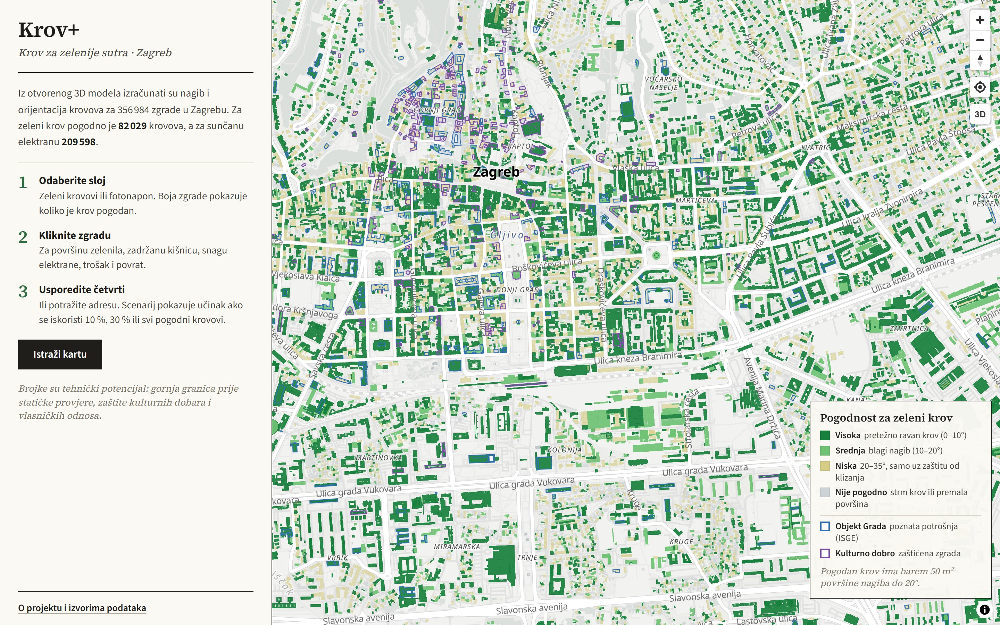

*Slika 1. Uvod pri prvom posjetu: kratko objašnjenje u lijevom panelu, karta je odmah upotrebljiva.*

**Što se vidi.** Pri prvom otvaranju lijevi panel prikazuje uvod: koliko je zgrada obrađeno, koliko je
krovova pogodno za zeleni krov i za sunčanu elektranu te tri koraka korištenja (odabir sloja, klik na
zgradu, usporedba četvrti). Karta desno već prikazuje zgrade.

**Kako se koristi.** Gumb „Istraži kartu“ zatvara uvod. Uvod se zatvara i sam pri prvom kliku na zgradu.

**Logika.** Uvod nije prozor preko karte, kako korisnik ne bi morao ništa zatvarati da bi vidio
rezultat. Aplikacija u pregledniku pamti samo podatak da je uvod već prikazan; ne prikuplja nikakve
druge podatke. Brojke u uvodu čitaju se iz istih sažetaka kao i ostatak aplikacije.

### 5.2 Pregled grada po gradskim četvrtima

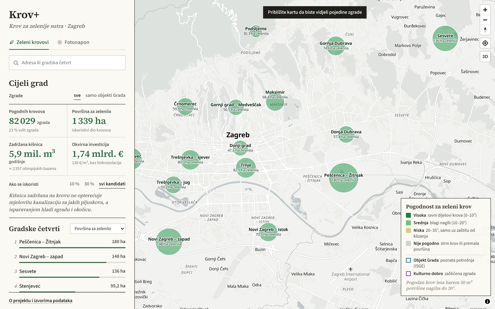

*Slika 2. Pregled cijelog grada: krug za svaku gradsku četvrt, veličina kruga odgovara potencijalu.*

**Što se vidi.** Kad je karta udaljena (cijeli grad), umjesto pojedinih zgrada prikazan je krug za
svaku od 17 gradskih četvrti s nazivom i ključnim brojem (površina za zelenilo ili proizvodnja struje).
Panel lijevo prikazuje brojke za cijeli grad i rang-listu četvrti.

**Kako se koristi.** Klik na krug ili na četvrt u rang-listi približava kartu na tu četvrt. Natpis na
vrhu karte poziva na približavanje radi pojedinih zgrada.

**Logika.**

* Pojedine zgrade prikazuju se od razine približavanja 13. Na manjem mjerilu 357 000 zgrada ne bi bilo
  čitljivo, a datoteka s kartom bila bi znatno veća.
* **Površina kruga** razmjerna je potencijalu četvrti (polumjer ∝ √vrijednost), pa se četvrti mogu
  izravno vizualno usporediti.
* Panel prikazuje četiri ključna pokazatelja za odabrani sloj:

| Zeleni krovovi | Značenje |
|---|---|
| Pogodnih krovova | zgrade s barem 50 m² krovnih ploha nagiba do 20° |
| Površina za zelenilo | 75 % pogodne površine (rubovi, instalacije i izlazi na krov se ne ozelenjuju) |
| Zadržana kišnica | iskoristiva površina × godišnja oborina (880 mm) × udio zadržane oborine (50 %); usporedba s olimpijskim bazenom od 2 500 m³ |
| Okvirna investicija | iskoristiva površina × 130 €/m², bez hidroizolacije |

### 5.3 Karta zelenih krovova

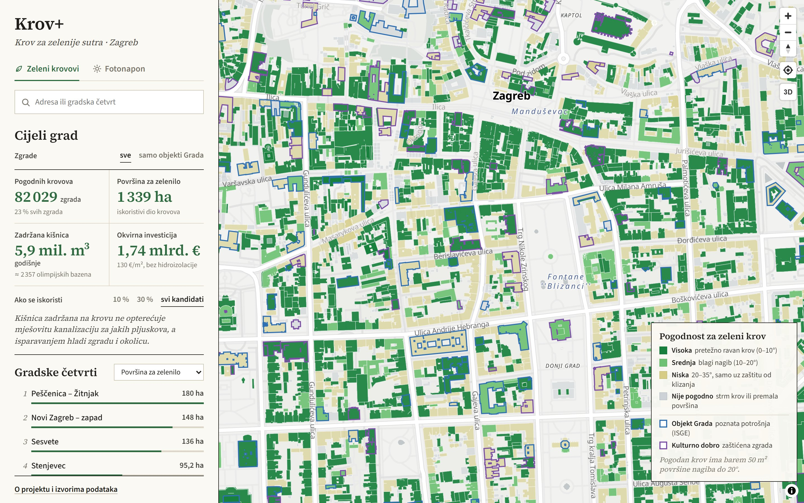

*Slika 3. Sloj „Zeleni krovovi“ u središtu grada: boja zgrade pokazuje pogodnost krova.*

**Što se vidi.** Svaka zgrada obojena je prema pogodnosti krova za zeleni krov. Plavim obrubom
označeni su objekti Grada s poznatom potrošnjom (ISGE), a ljubičastim zaštićena kulturna dobra.
Legenda dolje desno objašnjava boje.

**Logika razreda.** Pogodnost se određuje prema nagibu krovnih ploha, prema smjernicama FLL (Njemačko
društvo za razvoj i uređenje krajobraza) kako ih primjenjuje Gründachkataster pokrajine Sjeverna
Rajna-Vestfalija:

| Razred | Uvjet | Značenje |
|---|---|---|
| **Visoka** | zgrada je kandidat, a većina pogodne površine je nagiba 0–10° | ravni dijelovi krova: ekstenzivni i intenzivni zeleni krov |
| **Srednja** | zgrada je kandidat, pretežno nagiba 10–20° | blagi nagib: ekstenzivni zeleni krov (sedumi, trave) |
| **Niska** | nije kandidat, ali ima barem 50 m² ploha nagiba 20–35° | moguće samo uz zaštitu supstrata od klizanja |
| **Nije pogodno** | ostalo | prestrm krov ili premalo površine |

Zgrada je **kandidat** ako ima barem **50 m²** krovnih ploha nagiba do 20°. Zgrade koje nisu kandidati
prikazane su svjetlije, kako bi se pogodni krovovi isticali.

### 5.4 Karta sunčanih elektrana (fotonapon)

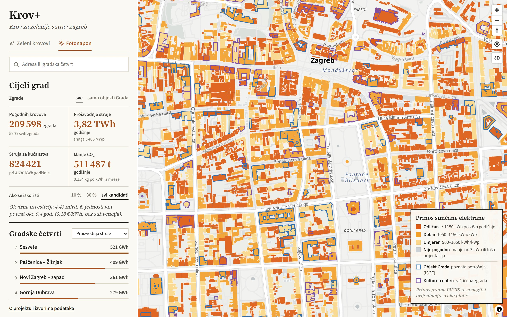

*Slika 4. Sloj „Fotonapon“ za isto područje: boja zgrade pokazuje očekivani prinos elektrane.*

**Što se vidi.** Prekidačem „Fotonapon“ ista karta prikazuje očekivani prinos sunčane elektrane po
zgradi. Panel prelazi na pokazatelje za fotonapon: broj pogodnih krovova, godišnju proizvodnju, ekvivalent
kućanstava i izbjegnute emisije CO₂, uz okvirnu investiciju i povrat ulaganja.

**Logika razreda.** Razred se određuje prema **specifičnom prinosu**, tj. koliko kWh godišnje daje
1 kWp instalirane snage na tom krovu:

| Razred | Prinos |
|---|---|
| **Odličan** | ≥ 1 150 kWh/kWp godišnje |
| **Dobar** | 1 050–1 150 kWh/kWp |
| **Umjeren** | 900–1 050 kWh/kWp |
| **Nije pogodno** | na krov stane manje od 3 kWp ili su plohe loše orijentirane |

Prinos za svaki nagib i orijentaciju dolazi iz **PVGIS-a** (Zajednički istraživački centar Europske
komisije), koji uzima u obzir stvarno sunčevo zračenje u Zagrebu (2005.–2023.) i zasjenjenje terenom.
Najbolji je krov nagiba 35° okrenut prema jugu (1 242 kWh/kWp). Na ravnim krovovima pretpostavljaju se
moduli na nosačima nagiba 15° prema jugu (~1 174 kWh/kWp), pa su ravni krovovi većinom u razredu „odličan“.

**Pokazatelji u panelu:**

| Pokazatelj | Izračun |
|---|---|
| Proizvodnja struje | zbroj proizvodnje svih pogodnih krovova (snaga × prinos) |
| Struja za kućanstva | proizvodnja / 4 630 kWh (prosječna godišnja potrošnja kućanstva u RH, Eurostat) |
| Manje CO₂ | proizvodnja × 0,134 kg CO₂ po kWh (intenzitet emisija proizvodnje struje u RH, EEA) |
| Investicija i povrat | snaga × 1 300 €/kWp; povrat = investicija / (proizvodnja × 0,18 €/kWh), bez subvencija |

### 5.5 Kartica zgrade

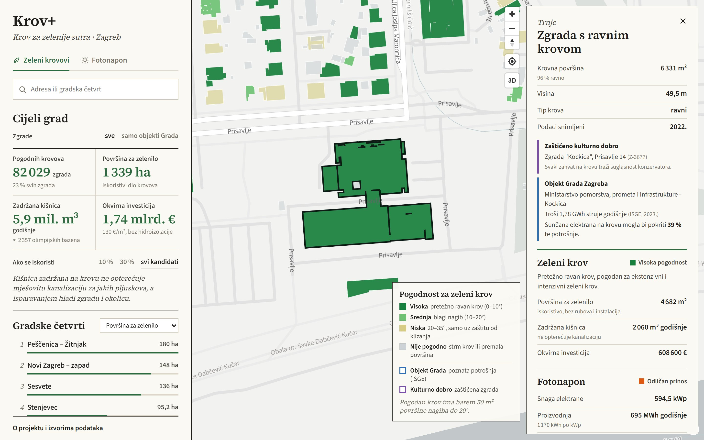

*Slika 5. Kartica zgrade „Kockica“ (Prisavlje 14): zaštićeno kulturno dobro i objekt Grada s potrošnjom.*

**Što se vidi.** Klik na zgradu otvara karticu desno, a zgrada dobiva crni obrub. Kartica ima četiri dijela:

1. **Osnovni podaci:** gradska četvrt, tip krova (ravni, kosi ili mješoviti), krovna površina i udio
   ravnog dijela, visina zgrade i godina snimanja podataka.
2. **Oznake iz povezanih izvora:** zaštićeno kulturno dobro (naziv i oznaka iz Registra) i objekt Grada
   Zagreba (naziv iz ISGE-a, godišnja potrošnja struje i udio koji bi pokrila elektrana na krovu).
3. **Zeleni krov:** razred pogodnosti s objašnjenjem, površina za zelenilo, zadržana kišnica i okvirna investicija.
4. **Fotonapon:** razred prinosa, snaga elektrane, godišnja proizvodnja, ekvivalent kućanstava, izbjegnute
   emisije, investicija i jednostavni povrat.

Na podnožju kartice stoje napomena o tehničkom potencijalu i identifikator zgrade.

**Primjer na slici.** „Kockica“ je ravna zgrada s 6 331 m² krova (96 % ravno). Pogodnost za zeleni krov
je visoka: 4 682 m² zelenila zadržalo bi ~2 060 m³ kišnice godišnje. Elektrana od 594,5 kWp proizvela bi
~695 MWh godišnje. Zgrada troši 1,78 GWh struje godišnje (ISGE, 2023.), pa bi elektrana pokrila **39 %**
potrošnje. Zgrada je ujedno zaštićeno kulturno dobro (Z-3677), pa bi zahvat tražio suglasnost konzervatora.

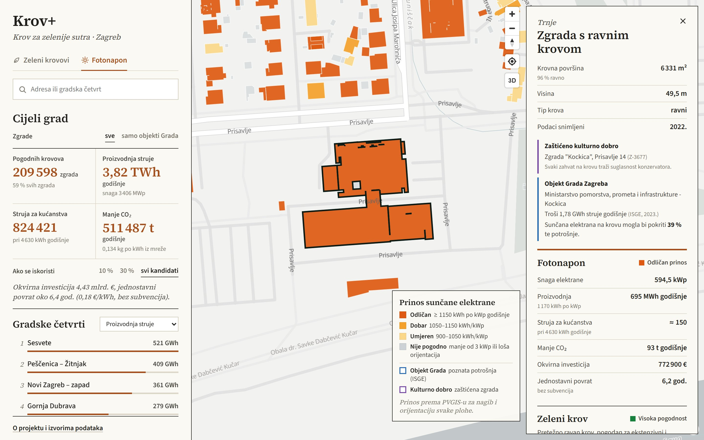

*Slika 6. Ista zgrada u sloju „Fotonapon“: odjeljak za fotonapon pomiče se na vrh kartice.*

**Logika kartice.**

* Odjeljak aktivnog sloja uvijek je prvi i istaknut je bojom sloja. Drugi odjeljak ostaje vidljiv, jer se
  na ravnom krovu zeleni krov i elektrana mogu kombinirati (biosolarni krov) ili natjecati za istu površinu.
* **Udio potrošnje koji FN može pokriti** = godišnja proizvodnja elektrane / godišnja potrošnja struje
  objekta. Prikazuje se samo za objekte s potrošnjom **≥ 20 MWh godišnje**. Manji potrošači (npr. uredi
  mjesne samouprave ili knjižnice u stambenoj zgradi) koriste samo dio zgrade, pa bi omjer prema elektrani
  na cijelom krovu bio višestruko prevelik. Za njih kartica prikazuje potrošnju i napomenu.
* Ako je elektrana veća od potrošnje, kartica piše da bi elektrana proizvela više struje nego što zgrada troši.
* **Godina snimanja**: dio modela potječe iz 2008. Kartica tada upozorava da su moguće novije promjene na krovu.

### 5.6 Zaštićeno kulturno dobro

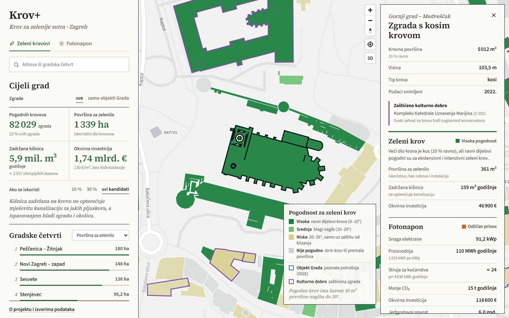

*Slika 7. Kompleks katedrale na Kaptolu: kartica upozorava na zaštitu kulturnog dobra.*

**Što se vidi.** Zgrade upisane u Registar kulturnih dobara imaju ljubičasti obrub na karti i oznaku
„Zaštićeno kulturno dobro“ s nazivom i registarskom oznakom u kartici.

**Logika.** Registar kulturnih dobara sadrži adrese, ali ne i koordinate. Adrese su automatski očišćene
(vodeće nule, više adresa u jednom zapisu, rasponi kućnih brojeva) i geokodirane preko OpenStreetMapa.
Prihvaćen je samo pogodak s kućnim brojem, a točka je vezana uz tlocrt zgrade u kojem leži ili uz
najbližu zgradu do 15 m. Tako je **368 od 470** kulturnih dobara s adresom vezano uz **393 zgrade**.
Kulturno dobro nije isključeno iz izračuna, nego je označeno: odluku o zahvatu donosi konzervator.

**Napomena o razredu.** Razred pogodnosti odnosi se na **pogodni dio krova**. Katedrala ima pretežno
kosi krov (10 % ravno), ali ravni i blago nagnuti dijelovi krova zajedno imaju više od 50 m², pa je
zgrada kandidat s 361 m² površine za zelenilo. Kad je ravnog krova manje od polovice, kartica to izričito
navodi („Veći dio krova je kos …, ali ravni dijelovi pogodni su …“). Brojke u kartici uvijek se odnose
samo na pogodne plohe.

### 5.7 Usporedba gradskih četvrti

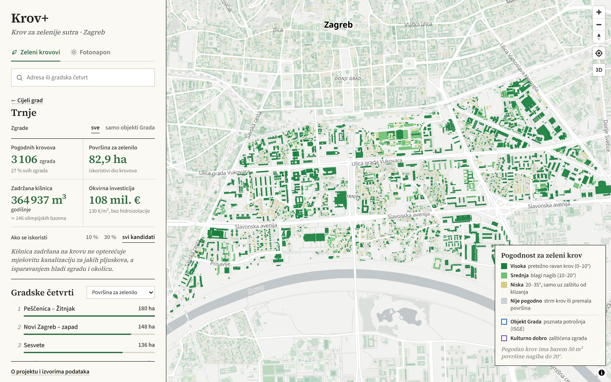

*Slika 8. Odabrana gradska četvrt Trnje: brojke u panelu odnose se na četvrt, ostatak grada je prigušen.*

**Što se vidi.** Nakon odabira četvrti (klik u rang-listi, na krug ili preko pretrage) karta se približi
na četvrt, zgrade izvan nje su prigušene, a panel prikazuje brojke samo za tu četvrt. Poveznica
„← Cijeli grad“ vraća pregled grada.

**Logika rang-liste.** Četvrti se mogu rangirati po tri kriterija za svaki sloj:

| Zeleni krovovi | Fotonapon |
|---|---|
| Površina za zelenilo (ha) | Proizvodnja struje (GWh godišnje) |
| Broj pogodnih krovova | Broj pogodnih krovova |
| Udio pogodnih zgrada (%) | Udio pogodnih zgrada (%) |

Apsolutni kriteriji pokazuju gdje je ukupni učinak najveći (najčešće velike rubne četvrti s puno
ravnih krovova). Udio pogodnih zgrada pokazuje gdje je stanje krovova najpovoljnije neovisno o veličini
četvrti. Traka uz svaku četvrt prikazuje vrijednost u odnosu na najveću.

### 5.8 Scenariji

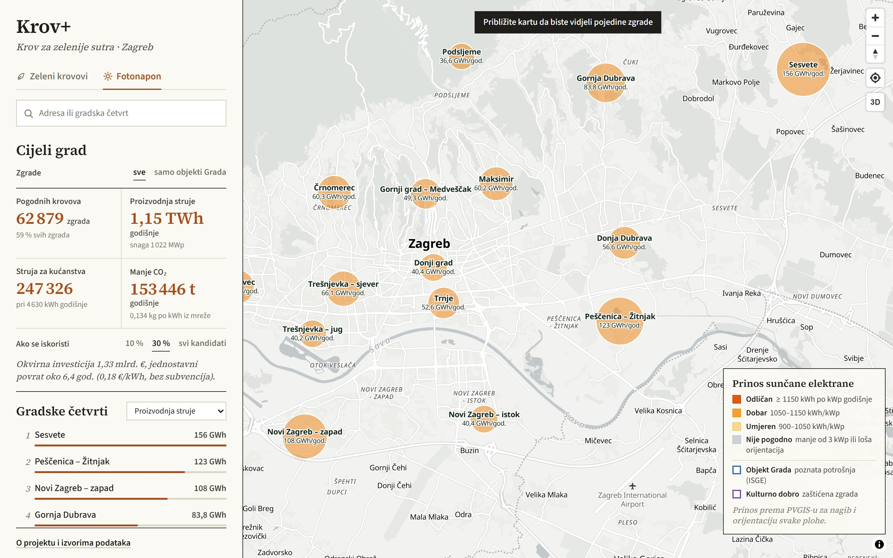

*Slika 9. Sloj „Fotonapon“ uz scenarij „30 %“: brojke u panelu, na krugovima i u rang-listi preračunate su za 30 % pogodnih krovova.*

**Što se vidi.** Prekidač „Ako se iskoristi: 10 % / 30 % / svi kandidati“ preračunava sve brojke za grad,
četvrti i krugove na karti.

**Logika.** Brojke prikazuju **tehnički potencijal**, tj. gornju granicu ako bi se iskoristili svi pogodni
krovovi. To u stvarnosti nije realno (nosivost, vlasnički odnosi, stanje krova). Scenarij linearno
skalira zbrojeve (npr. 30 % kandidata daje 30 % površine, vode, proizvodnje i troška). Tako se jednostavno
dobiva realan cilj za program ili strategiju. Boje pojedinih zgrada se ne mijenjaju, jer se scenarij
odnosi na zbroj, a ne na odabir konkretnih zgrada.

### 5.9 Samo objekti Grada

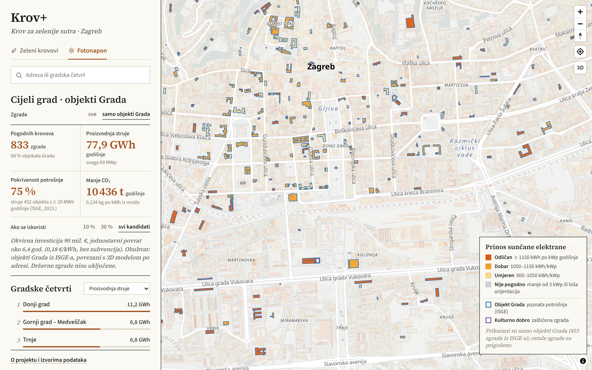

*Slika 10. Prikaz „samo objekti Grada“ u sloju „Fotonapon“: istaknute su samo zgrade iz ISGE-a, ostale su prigušene.*

**Što se vidi.** Prekidač „Zgrade: sve / samo objekti Grada“ ograničava brojke, rang-listu i kartu na
**853 zgrade** koje koristi Grad Zagreb i čiju potrošnju energije prati Informacijski sustav za
gospodarenje energijom (ISGE). U sloju „Fotonapon“ treći pokazatelj postaje **pokrivenost potrošnje**:
koliki bi dio vlastite potrošnje struje tih objekata pokrile elektrane na njihovim krovovima.

**Logika.**

* Potrošnja je preuzeta iz skupa „Podaci o potrošnji i trošku za objekte Grada Zagreba“ (data.gov.hr),
  za električnu energiju u **2023.** (posljednja godina sa svih 12 mjeseci).
* Adrese objekata geokodirane su istim postupkom kao kulturna dobra: **854 zgrade** od 1 082 objekta s
  potrošnjom struje. Više objekata na istoj zgradi se zbraja.
* **Pokrivenost potrošnje** = Σ proizvodnja FN / Σ potrošnja, samo za 452 objekta s potrošnjom
  ≥ 20 MWh godišnje (vidi 5.5). Za cijeli grad: 54,4 GWh / 72,9 GWh ≈ **75 %**. To je tehnički potencijal,
  bez pohrane energije i bez vremenskog usklađivanja proizvodnje i potrošnje.
* Obuhvat su samo objekti Grada iz ISGE-a. Državne zgrade (ministarstva, fakulteti, bolnice u vlasništvu
  države) nisu uključene.

**Zašto je to važno.** Na vlastitim zgradama Grad sam odlučuje, poznaje potrošnju i može ulaganje
uključiti u proračun ili javni poziv. To su najbrži prvi koraci.

### 5.10 3D prikaz

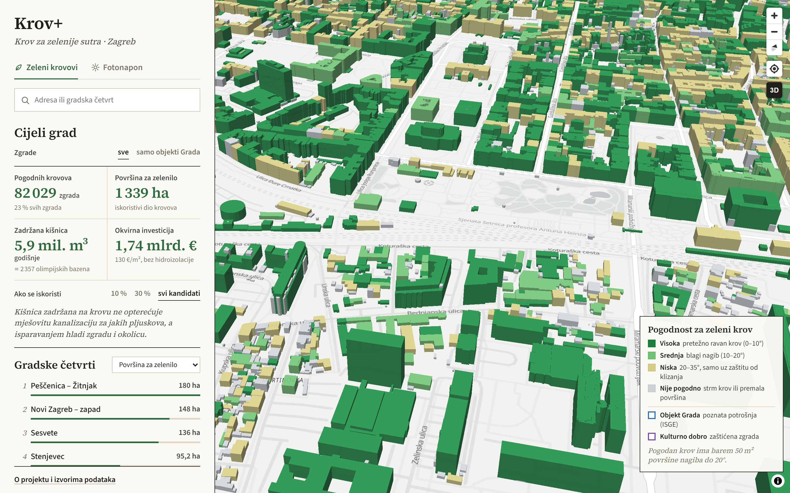

*Slika 11. 3D prikaz: zgrade s visinom iz 3D modela, obojene prema odabranom sloju.*

**Što se vidi.** Gumb „3D“ naginje kartu i prikazuje zgrade s njihovom stvarnom visinom iz ZG3D-a.
Boje i kartica zgrade rade jednako kao u 2D prikazu.

**Logika.** 3D prikaz pomaže prepoznati zgrade i razumjeti kontekst (visoke zgrade, unutarnja dvorišta).
Uključuje se i automatski kad korisnik nagne kartu (desni klik i povlačenje ili dva prsta na mobitelu).

### 5.11 Pretraga

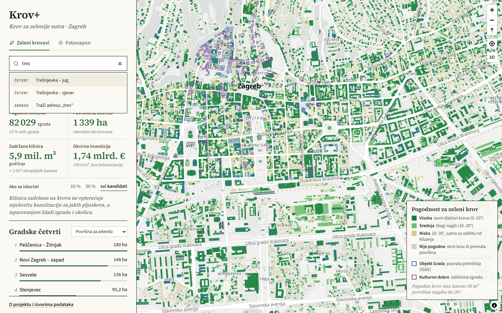

*Slika 12. Pretraga: gradske četvrti nude se odmah, a adresa se traži na Enter.*

**Što se vidi.** Polje za pretragu nudi gradske četvrti već tijekom upisa, i bez dijakritika
(„tres“ pronalazi Trešnjevku). Za adresu se upit šalje pritiskom na Enter.

**Logika.** Četvrti se pretražuju lokalno. Adresa se traži preko usluge Nominatim (OpenStreetMap),
ograničeno na područje Zagreba. Upit se šalje samo na Enter, u skladu s pravilima korištenja usluge
(najviše jedan upit u sekundi). Karta se zatim približi na adresu i otvori kartica zgrade na tom mjestu.

### 5.12 O projektu i izvori podataka

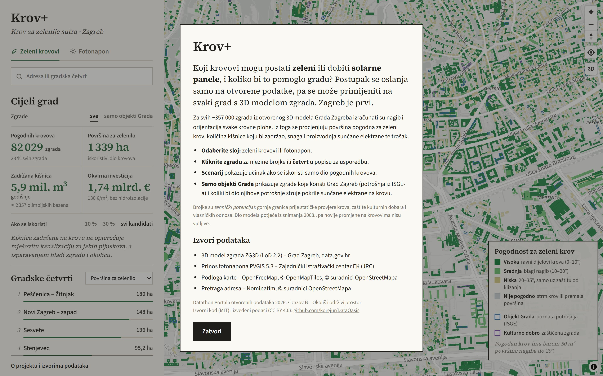

*Slika 13. Prozor „O projektu i izvorima podataka“, dostupan iz podnožja panela.*

**Što se vidi.** Kratko objašnjenje postupka i korištenja, napomena o tehničkom potencijalu i
ograničenjima, popis izvora podataka s izdavateljima te poveznica na izvorni kod i licence.

**Logika.** Navođenje izvora traže uvjeti korištenja otvorenih podataka (Otvorena dozvola, ODbL) i
pravila natjecanja. Napomena o tehničkom potencijalu vidljiva je i u uvodu i u svakoj kartici zgrade,
kako se brojke ne bi tumačile kao izvedbeni projekt.

### 5.13 Prikaz na mobitelu

  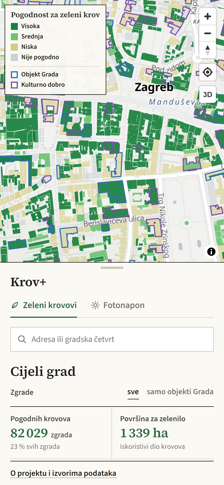
  &nbsp;&nbsp;
  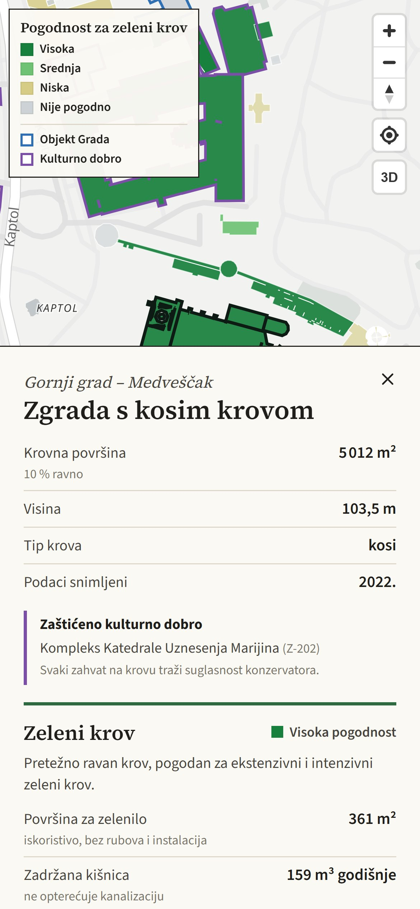

*Slika 14. (lijevo) Karta s panelom kao donjim listom. Slika 15. (desno) Kartica zgrade na mobitelu.*

**Logika.** Na zaslonima užim od 760 px panel i kartica postaju donji listovi (panel se proširuje
dodirom na ručicu), a legenda se skraćuje i premješta u gornji lijevi kut. Sve funkcionalnosti dostupne su i
na mobitelu, što je važno za terenski rad i za građane.

## 6. Rezultati za Grad Zagreb

Tehnički potencijal (gornja granica prije statičke provjere, zaštite kulturnih dobara i vlasničkih
odnosa). Izvor: izračun iz ZG3D-a, parametri u Tehničkoj dokumentaciji, Prilog A.

| Pokazatelj | Cijeli grad | Samo objekti Grada (ISGE) |
|---|---|---|
| Zgrade | 356 984 | 853 |
| Ukupna krovna površina | 40,5 km² | 0,73 km² |
| Kandidati za zeleni krov | **82 029 zgrada** (23 %) | 611 zgrada |
| Iskoristiva površina za zelenilo | 1 339 ha | 37 ha |
| Zadržana kišnica | **~5,9 mil. m³ godišnje** | ~163 000 m³ godišnje |
| Okvirna investicija, zeleni krovovi | ~1,74 mlrd. € | ~48 mil. € |
| Kandidati za FN | **209 598 zgrada** (59 %) | 833 zgrade |
| Snaga FN | 3,4 GWp | 69 MWp |
| Proizvodnja FN | **~3,8 TWh godišnje** | ~78 GWh godišnje |
| Izbjegnute emisije CO₂ | ~511 000 t godišnje | ~10 400 t godišnje |
| Okvirna investicija, FN | ~4,43 mlrd. € (povrat ~6,4 god.) | ~90 mil. € (povrat ~6,4 god.) |
| Pokrivenost vlastite potrošnje struje | – | **~75 %** (452 objekta s ≥ 20 MWh/god) |

**Gradske četvrti s najvećim potencijalom:**

* zeleni krovovi (površina za zelenilo): Peščenica – Žitnjak (180 ha), Novi Zagreb – zapad (148 ha), Sesvete (136 ha);
* fotonapon (proizvodnja): Sesvete (521 GWh), Peščenica – Žitnjak (409 GWh), Novi Zagreb – zapad (361 GWh).

Ekvivalent kućanstava za cijeli grad (~824 000) veći je od broja kućanstava u Zagrebu: to je tehnički
potencijal svih krovova, a ne preporuka. Zato aplikacija nudi scenarije od 10 % i 30 %.

## 7. Korisnička vrijednost

* **Odluke na temelju podataka.** Umjesto procjene „od oka“ Grad vidi gdje je potencijal najveći, koliki
  je učinak i koliko bi koštao, za cijeli grad, četvrt ili pojedinu zgradu.
* **Klimatska prilagodba.** Zadržana kišnica izravno smanjuje opterećenje mješovite kanalizacije pri jakim
  pljuskovima, a zeleni krovovi smanjuju pregrijavanje zgrada i ulica.
* **Energetska tranzicija.** Prikaz pokazuje koliko struje krovovi mogu proizvesti i koliki dio vlastite
  potrošnje Grad može pokriti na svojim zgradama.
* **Brzi prvi koraci.** Objekti Grada imaju jednog vlasnika i poznatu potrošnju, pa se mogu odmah
  uključiti u program ulaganja ili javni poziv.
* **Povezivanje podataka koji inače stoje odvojeno.** 3D model zgrada, potrošnja energije i zaštita
  baštine nalaze se na istoj karti, na razini pojedine zgrade.
* **Bez troška korištenja.** Aplikacija je statička, radi u pregledniku bez prijave, a hosting je besplatan.
* **Otvoreno i ponovljivo.** Kod (MIT) i izvedeni podaci (CC BY 4.0) su javni. Kad Grad objavi novu verziju
  3D modela, izračun se ponovno pokreće bez izmjene koda. Isti postupak primjenjiv je na svaki grad s LoD 2 modelom.

## 8. Ograničenja i pouzdanost rezultata

| Ograničenje | Posljedica | Kako je riješeno u aplikaciji |
|---|---|---|
| Dio modela potječe iz snimanja 2008. | novije promjene (nadogradnje, postojeće elektrane) nisu vidljive | kartica prikazuje godinu snimanja i upozorenje |
| Nosivost krova nije poznata | rezultat znači „kandidat za statičku provjeru“, a ne „izvedivo“ | napomena o tehničkom potencijalu u uvodu i kartici |
| Zasjenjenje susjednim zgradama i drvećem nije uključeno | prinos FN može biti precijenjen u gustim blokovima | PVGIS uključuje zasjenjenje terenom |
| Krovne instalacije (klima uređaji, izlazi) | stvarna iskoristiva površina može biti manja | paušalni faktor 0,75 za zelene krovove i 0,70 / 0,50 za FN |
| Povezivanje po adresi (geokodiranje) | dio zapisa nije povezan ili je povezan s pogrešnom zgradom | prihvaća se samo pogodak s kućnim brojem; 368/470 kulturnih dobara i 854 zgrade iz ISGE-a |
| Ekonomski parametri se mijenjaju | trošak i povrat su okvirni | parametri s izvorom i datumom u Prilogu A Tehničke dokumentacije |

**Kontrola kvalitete geometrije.** Za Gornji grad tlocrt dobiven iz krovnih ploha uspoređen je sa
službenim 2D tlocrtom (medijan omjera 1,000) i visina zgrade s atributom modela (medijan razlike
0,000 m). Detalji su u Tehničkoj dokumentaciji, poglavlje 3.2.

## 9. Daljnji razvoj

1. **Prioritizacija „gdje najviše treba“.** Spoj s ljetnom temperaturom površine (Landsat), nedostatkom
   zelenila (Sentinel-2), gustoćom stanovništva i blizinom vrtića, škola i domova za starije (Geoportal
   Grada Zagreba), uz klizače za težine kriterija u aplikaciji.
2. **Javne ustanove i granice četvrti s Geoportala** kao sloj na karti i u kartici zgrade.
3. **Zasjenjenje iz 3D modela** (sjena susjednih zgrada) za točniji prinos sunčanih elektrana.
4. **Prepoznavanje postojećih zelenih krovova i elektrana** na ortofotu Državne geodetske uprave pomoću
   računalnog vida, kako bi se iz potencijala izuzeli već iskorišteni krovovi.
5. **Biosolarni krov** (elektrana iznad zelenog krova) kao zaseban scenarij, uz veći prinos zbog
   hlađenja modula.
6. **Objava rezultata kao otvorenog skupa** na data.gov.hr i kao sloja na Geoportalu Grada (WMS/WFS).
7. **Primjena na druge gradove** koji objave LoD 2 model zgrada.

## 10. Tim, alati i izvori

**Tim** je radio u tri uloge: aplikacija (karta, povezivanje podataka, objava), podaci (otvoreni skupovi
i prostorni podaci) i metodologija (parametri, izvori, validacija, video).

**Alati.** Sav korišteni softver je otvorenog koda: Python (NumPy, pandas, GeoPandas, Shapely, pyproj,
pyogrio/GDAL, PyArrow) za obradu podataka te MapLibre GL JS, PMTiles i Vite za web aplikaciju.
Korišteni AI alati: **Claude Code (Anthropic)** kao pomoć pri pisanju koda i dokumentacije, **GPT (OpenAI)**
za generiranje likova za video i **Kling AI 4.0 (Kuaishou)** za generiranje dvaju kadrova s likovima u videu.
Potpun popis alata s verzijama i licencama nalazi se u Tehničkoj dokumentaciji, poglavlje 9.

**Izvori podataka:**

| Skup podataka | Izdavatelj | Licenca |
|---|---|---|
| ZG3D – 3D model zgrada, LoD 2.2 (17 gradskih četvrti) | Grad Zagreb, data.gov.hr | Otvorena dozvola |
| Podaci o potrošnji i trošku za objekte Grada Zagreba (ISGE) | Grad Zagreb, data.gov.hr | Otvorena dozvola |
| Registar kulturnih dobara | Ministarstvo kulture i medija, data.gov.hr | Otvorena dozvola |
| PVGIS 5.3 | Zajednički istraživački centar EK (JRC) | uz navođenje izvora |
| Klimatološki podaci (oborine) | DHMZ | uz navođenje izvora |
| Intenzitet emisija proizvodnje el. energije | Europska agencija za okoliš (EEA) | CC BY 4.0 |
| Cijene el. energije, energetska bilanca, broj kućanstava | Eurostat | uz navođenje izvora |
| OpenStreetMap (podloga karte, geokodiranje) | suradnici OpenStreetMapa | ODbL |

Potpun popis s poveznicama nalazi se u Tehničkoj dokumentaciji, poglavlje 8.
