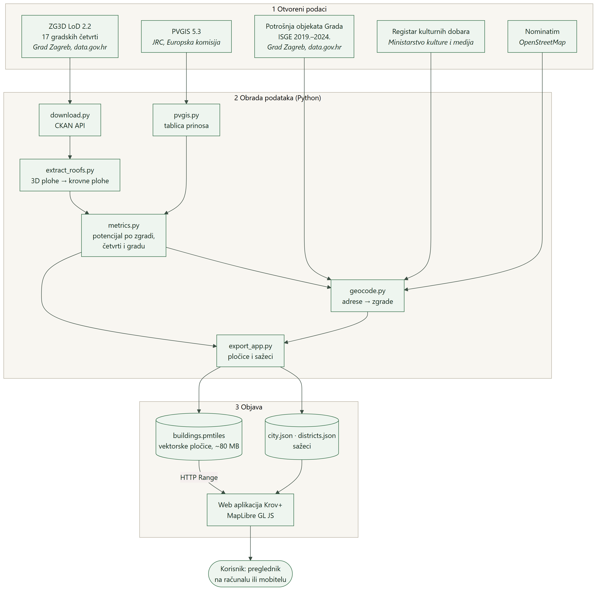
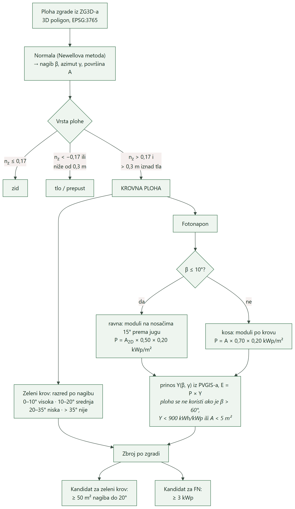
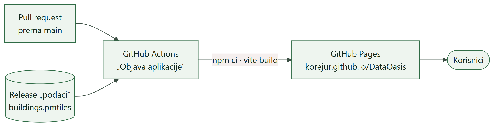

# Krov+

## Tehnička dokumentacija

**Arhitektura sustava, obrada podataka, standardi, integracija i popis skupova podataka**

**Natjecanje:** Datathon Portala otvorenih podataka 2026., izazov B – Okoliš i održivi prostor  
**Tim:** Korina Jurić, Marko Ćurković, Mario Mrvčić  
**Mentor:** prof. dr. sc. Boris Milašinović  
**Aplikacija:** https://korejur.github.io/DataOasis/  
**Izvorni kod:** https://github.com/korejur/DataOasis (licenca MIT)  
**Izvedeni podaci:** CC BY 4.0, prilog Releasea [`podaci`](https://github.com/korejur/DataOasis/releases/tag/podaci)  
**Verzija dokumenta:** 1.0, studeni 2026.  
**Povezani dokument:** Krov+ – Projektna dokumentacija

<div style="page-break-after: always;"></div>

## Sadržaj

1. Pregled sustava
2. Arhitektura
3. Obrada podataka (pipeline)
4. Model podataka
5. Web aplikacija
6. Objava i održavanje
7. Standardi i formati
8. Popis skupova podataka
9. Korišteni alati i biblioteke
10. Integracija s javnim sustavima
11. Preduvjeti (tehnički, organizacijski, pravni)
12. Ograničenja i poznati problemi

Prilog A. Parametri izračuna i njihovi izvori

<div style="page-break-after: always;"></div>

## 1. Pregled sustava

Krov+ se sastoji od dva dijela:

* **Obrada podataka (pipeline, Python).** Preuzima otvorene podatke, iz 3D modela zgrada izdvaja krovne
  plohe, računa potencijal zelenog krova i sunčane elektrane za svaku zgradu, povezuje rezultat s drugim
  skupovima i izvozi podatke za web.
* **Web aplikacija (JavaScript).** Statička stranica koja rezultate prikazuje na interaktivnoj karti.

Nema poslužitelja s bazom podataka ni vlastitog API-ja. Svi izračuni rade se unaprijed, a aplikacija
čita gotove datoteke sa statičkog hostinga.

**Razlozi za takvu arhitekturu:**

| Zahtjev | Rješenje |
|---|---|
| Izračun za 356 984 zgrade iz ~1,2 GB 3D geometrije | radi se unaprijed, jednom po izmjeni podataka ili parametara |
| Pouzdan javni link bez održavanja | statički hosting (GitHub Pages), nema poslužitelja koji može pasti |
| Brzo učitavanje karte | vektorske pločice: preglednik dohvaća samo pločice za vidljivi dio grada |
| Bez troška | besplatan hosting, bez API ključeva |
| Privatnost | aplikacija ne šalje podatke o korisniku nikamo osim upita za adresu |
| Ponovljivost | cijeli postupak pokreće se naredbama iz README-a; parametri na jednom mjestu |

**Opseg obrade:**

| Veličina | Vrijednost |
|---|---|
| Ulazni 3D model (17 gradskih četvrti, FGDB) | ~1,2 GB |
| Zgrade nakon uklanjanja duplikata | 356 984 |
| Ukupna krovna površina | 40,5 km² |
| Upiti prema PVGIS-u | ~300 |
| Geokodirane adrese (kulturna dobra i ISGE) | 1 515 |
| Vektorske pločice za web | ~80 MB, razine 13–16 |

<div style="page-break-after: always;"></div>

## 2. Arhitektura



*Slika 1. Arhitektura sustava: otvoreni podaci, obrada podataka unaprijed i objava na statičkom hostingu.*

Tok podataka ima tri razine:

1. **Otvoreni podaci.** ZG3D, ISGE i Registar kulturnih dobara s Portala otvorenih podataka (data.gov.hr),
   PVGIS (Europska komisija) i Nominatim (OpenStreetMap).
2. **Obrada podataka.** Šest Python modula u mapi `pipeline/`. Svaki modul čita rezultate prethodnog iz
   `data/` i zapisuje svoje. Svi parametri izračuna nalaze se u `pipeline/config.py`.
3. **Objava.** Izvoz (`export_app.py`) stvara datoteku s vektorskim pločicama i JSON sažetke. Web aplikacija
   ih čita izravno sa statičkog hostinga. Iz datoteke s pločicama čita samo potrebne dijelove (HTTP Range).

Jedina vanjska usluga koju aplikacija koristi tijekom rada je pretraga adrese (Nominatim), i to samo kad
korisnik pritisne Enter. Podloga karte učitava se s OpenFreeMapa.

**Struktura repozitorija:**

```
pipeline/            obrada podataka (Python)
  config.py          putanje, popis četvrti, svi parametri izračuna
  download.py        1  preuzimanje ZG3D-a (CKAN API)
  extract_roofs.py   2  3D plohe → krovne plohe
  pvgis.py           3  tablica prinosa FN (PVGIS API)
  metrics.py         4  potencijal po zgradi, četvrti i gradu
  geocode.py         5  geokodiranje kulturnih dobara i ISGE objekata
  export_app.py      6  izvoz za web (pločice i sažeci)
data/
  reference/         pomoćni skupovi (PVGIS, kulturna dobra, ISGE, predmemorija geokodiranja)
  raw/, processed/   preuzeti podaci i rezultati (nastaju pokretanjem, nisu u gitu)
app/                 web aplikacija (Vite + MapLibre GL JS + PMTiles)
docs/                dokumentacija
.github/workflows/   automatska objava na GitHub Pages
```

<div style="page-break-after: always;"></div>

## 3. Obrada podataka (pipeline)

| Korak | Modul | Ulaz → izlaz | Trajanje |
|---|---|---|---|
| 1 | `download.py` | CKAN API data.gov.hr → `data/raw/zg3d/` (FGDB) | nekoliko minuta (preuzimanje ~1,2 GB) |
| 2 | `extract_roofs.py` | 3D plohe → `data/processed/faces/`, `buildings/` (GeoParquet) | nekoliko minuta, četvrti paralelno |
| 3 | `pvgis.py` | PVGIS API → `data/reference/pvgis_zagreb.json` | ~300 upita |
| 4 | `metrics.py` | plohe + prinos → `buildings_metrics.parquet`, sažeci po četvrti i gradu | ~30 s |
| 5 | `geocode.py` | Registar, ISGE, Nominatim → `heritage_buildings.parquet`, `isge_buildings.parquet` | ~1 min uz predmemoriju |
| 6 | `export_app.py` | sve → `app/public/data/` | ~6 min |

Promjena parametra izračuna zahtijeva ponovno pokretanje samo koraka 4 i 6. Geometrija se ne obrađuje ponovno.

### 3.1 Preuzimanje (`download.py`)

* Za svaku od 17 gradskih četvrti modul preko **CKAN Action API-ja** (`package_show`) čita metapodatke
  skupa na data.gov.hr i pronalazi poveznicu na datoteku u formatu FGDB. Poveznice se ne pišu u kod, pa
  postupak radi i kad izdavatelj zamijeni datoteke.
* Arhive se raspakiraju uz provjeru putanja (zaštita od zapisa izvan ciljne mape).
* FGDB je jedini format skupa koji čuva 3D geometriju krovova (multipatch). CSV, GeoJSON i SHP s istog
  skupa sadrže samo 2D tlocrt. Ako GDAL ne može pročitati FGDB (Novi Zagreb – zapad ima sloj tipa
  „Unknown ZM“), automatski se koristi SHP verzija s multipatch geometrijom.

### 3.2 Geometrija krovova (`extract_roofs.py`)

Svaka zgrada u ZG3D-u skup je ravnih 3D ploha (krov, zidovi, tlo). Geometrija je zapisana kao
`GeometryCollection(TIN, Polygon)`, koju standardne biblioteke ne čitaju, pa je napisan **vlastiti
parser WKB zapisa** (`parse_faces`).

Za svaku plohu, u koordinatama HTRS96/TM (EPSG:3765, metri):

* **vektor površine** (Newellova metoda) za prsten točaka (xᵢ, yᵢ, zᵢ):
  `Nx = ½ Σ (yᵢ − yᵢ₊₁)(zᵢ + zᵢ₊₁)`, `Ny = ½ Σ (zᵢ − zᵢ₊₁)(xᵢ + xᵢ₊₁)`, `Nz = ½ Σ (xᵢ − xᵢ₊₁)(yᵢ + yᵢ₊₁)`
* **stvarna (kosa) površina**: `A = |N_vanjski| − Σ |N_rupa|`
* **jedinična normala**: `n = −N / |N|` (Esri zapis: prstenovi u smjeru kazaljke na satu)
* **nagib**: `β = arccos(n_z)`
* **azimut** (smjer u koji ploha gleda): `γ = atan2(n_x, n_y)`, 0° = sjever, 90° = istok, 180° = jug
* **tlocrtna površina**: `A_2D = A · n_z`

**Klasifikacija ploha:**

| Vrsta | Uvjet |
|---|---|
| krov | `n_z > 0,17` (nagib manji od ~80°) i ploha je više od 0,3 m iznad najniže točke zgrade |
| zid | −0,17 ≤ `n_z` ≤ 0,17 (okomite plohe) |
| ostalo | tlo zgrade, donje strane prepusta (`n_z < −0,17`) |

**Posebnosti izvornih podataka riješene u obradi:**

| Problem | Rješenje |
|---|---|
| Dio zgrada zapisan je s obrnutim redoslijedom točaka (npr. 190 od 15 029 u Gornjem gradu) | ako je površina ploha iznad tla okrenutih prema dolje veća od onih prema gore, normale zgrade se okreću |
| Tri četvrti objavljene su u EPSG:3765, ostale u EPSG:4326 | koordinatni sustav čita se iz svake datoteke |
| 537 zgrada na granicama četvrti nalazi se u dva skupa, 685 objekata upisano je dvaput u istoj četvrti | uklanjanje duplikata prema centroidu (10 cm), visini i površini krova |
| 54,5 % zgrada potječe iz snimanja 2008., a 45,3 % iz 2022. | godina izvora čuva se uz zgradu i prikazuje u kartici |

**Kontrola kvalitete (Gornji grad):** tlocrt dobiven iz krovnih ploha u odnosu na službeni 2D tlocrt ima
medijan omjera 1,000 (5. percentil 0,999, 95. percentil 1,000), a visina zgrade poklapa se s atributom
`Z_Delta` (medijan razlike 0,000 m). Bez krovne plohe ostaje 60 objekata (ploče niže od 0,3 m i otvorene
ljuske poput tornjeva), što je ispravno.

### 3.3 Logika izračuna po plohi i zgradi



*Slika 2. Od 3D plohe do kandidata za zeleni krov i sunčanu elektranu.*

### 3.4 Prinos sunčane elektrane (`pvgis.py`)

* Upiti prema **PVGIS 5.3 API-ju** (JRC) za Zagreb (45,813° N, 15,977° E): mreža nagiba 0–90° (korak 5°)
  × azimuta 0–345° (korak 15°), baza zračenja SARAH3 (2005.–2023.), gubici sustava 14 %, horizont iz
  digitalnog modela terena.
* Rezultat je tablica godišnjeg prinosa u kWh/kWp. Za svaku plohu prinos se dobiva **bilinearnom
  interpolacijom** po nagibu i azimutu.
* Optimum je 35° prema jugu (1 242 kWh/kWp), vodoravna ploha daje 1 053 kWh/kWp.

### 3.5 Potencijal po zgradi (`metrics.py`)

**Zeleni krov**

* razred plohe po nagibu: 0–10° visoka, 10–20° srednja, 20–35° niska, iznad 35° neprikladno (FLL 2018);
* `prikladna površina = Σ A` ploha razreda visoka i srednja;
* `iskoristiva površina A_isk = prikladna × 0,75`;
* zgrada je **kandidat** ako je prikladna površina ≥ 50 m²;
* **zadržana oborina** [m³/god] = `A_isk × 0,880 m × 0,50`;
* **trošak** [€] = `A_isk × 130 €/m²`.

Razred zgrade za kartu: *visoka* ako je kandidat i barem polovina prikladne površine ima nagib do 10°,
*srednja* za ostale kandidate, *niska* ako nije kandidat, ali ima ≥ 50 m² ploha nagiba 20–35°, inače *nije pogodno*.

**Fotonapon**

* **kosa ploha** (nagib > 10°): moduli po krovu, `P = A × 0,70 × 0,20 kWp/m²`, prinos `Y(β, γ)`;
* **ravna ploha** (nagib ≤ 10°): moduli na nosačima 15° prema jugu u redovima,
  `P = A_2D × 0,50 × 0,20 kWp/m²`, prinos `Y(15°, 180°)` ≈ 1 174 kWh/kWp;
* ploha se ne koristi ako je strmija od 60°, ima prinos manji od 900 kWh/kWp ili je manja od 5 m²;
* `E [kWh/god] = Σ P × Y`; zgrada je **kandidat** ako stane ≥ 3 kWp;
* **CO₂** [t/god] = `E × 0,134 / 1000`;
* **ekvivalent kućanstava** = `E / 4 630`;
* **investicija** [€] = `P × 1 300`; **jednostavni povrat** [god] = `investicija / (E × 0,18)`.

**Zbrojevi** po gradskoj četvrti i za grad računaju se istom funkcijom (`summarize`) za sve zgrade i
posebno za objekte Grada (ključ `javno` u sažecima).

### 3.6 Povezivanje adresa sa zgradama (`geocode.py`)

Registar kulturnih dobara i ISGE imaju adrese, ali ne i koordinate. Postupak:

1. **Izbor zapisa.** Registar: pojedinačna nepokretna kulturna dobra u Gradu Zagrebu s adresom (470 dobara,
   555 adresa). ISGE: objekti s potrošnjom električne energije u 2023. (1 082 objekta).
2. **Čišćenje adresa.** Uklanjanje vodećih nula („Ilica 002“ → „Ilica 2“), razdvajanje više adresa u jednom
   zapisu („Opatička 02-Kamenita 02“), prvi broj iz raspona („Masarykova 21-23“), raspisivanje kratica
   („Av.“ → „Avenija“, „Al.“ → „Aleja“).
3. **Geokodiranje** preko Nominatima (OpenStreetMap), najviše 1 upit u sekundi, unutar okvira Grada Zagreba.
   Redom se pokušava strukturirani upit (ulica + naselje), slobodni upit, pa isto za naselje „Zagreb“.
   Prihvaća se samo pogodak **s kućnim brojem**. Odgovori se spremaju u `data/reference/geocode/nominatim.json`,
   pa je postupak ponovljiv bez novih upita.
4. **Spajanje sa zgradom.** Točka se veže uz tlocrt zgrade u kojem leži, a ako takvog nema, uz najbližu
   zgradu udaljenu do 15 m (EPSG:3765).
5. **Udio potrošnje koji FN može pokriti** = `E_FN / E_potrošnja`, samo za objekte s potrošnjom ≥ 20 MWh/god
   (manji potrošači koriste samo dio zgrade). Više objekata na istoj zgradi se zbraja.

**Rezultat:** kulturna dobra 368 od 470 vezano je uz 393 zgrade (383 točke unutar tlocrta, 22 uz najbližu
zgradu); ISGE 854 zgrade od 1 082 objekta. Od 1 515 jedinstvenih adresa 1 299 (86 %) pronađeno je s kućnim brojem.

### 3.7 Izvoz za web (`export_app.py`)

* **Vektorske pločice:** GDAL (driver PMTiles, preko pyogrio), sloj `buildings`, razine 13–16,
  pojednostavljenje tlocrta 0,3 m (ispod vizualnog praga na razini 16), najveća pločica 3 MB, atributi u
  UTF-8. Ispod razine 13 pločice središta grada bile bi prevelike i GDAL bi odbacio dio zgrada.
* Izvoz spaja sve predane tablice vezane uz zgradu (`bldg_id`) koje postoje u `data/processed/`:
  kulturna dobra, ISGE i, kad budu dostupne, javne ustanove.
* **JSON sažeci:** `city.json` (zbrojevi za grad i korišteni parametri) i `districts.json` (zbrojevi i okvir
  za svaku četvrt). Opcija `--samo-json` izvozi samo sažetke u nekoliko sekundi.

<div style="page-break-after: always;"></div>

## 4. Model podataka

**Ključ zgrade** je `bldg_id` u obliku `<četvrt>:<redni broj>` (npr. `trnje:10428`). Sve tablice vezane
uz zgradu imaju taj stupac.

**Tablice u `data/processed/`** (GeoParquet, EPSG:3765):

| Datoteka | Sadržaj |
|---|---|
| `faces/<četvrt>.parquet` | sve krovne plohe: 3D poligon, površina, nagib, azimut, visina |
| `buildings/<četvrt>.parquet` | zgrade: tlocrt krova, visina, površine krova i zidova, godina izvora |
| `buildings_metrics.parquet` | zgrade s potencijalom zelenog krova i FN, troškovima i doprinosima |
| `heritage_buildings.parquet` | `bldg_id`, `heritage_id`, `naziv`, `status`, `adresa`, `nacin` |
| `isge_buildings.parquet` | `bldg_id`, `objekt`, `adresa`, `kwh_god`, `eur_god`, `fn_udio`, `nacin` |
| `district_summary.csv`, `city_summary.json` | zbrojevi po četvrti i za grad |

**Atributi zgrade u vektorskim pločicama** (`buildings.pmtiles`, sloj `buildings`):

| Atribut | Značenje | Jedinica |
|---|---|---|
| `id` | ključ zgrade (`bldg_id`) | – |
| `cetvrt`, `god` | gradska četvrt, godina snimanja | – |
| `h`, `krov`, `krov_m2`, `ravno_pct` | visina, tip krova, krovna površina, udio ravnog krova | m, –, m², % |
| `zk` | razred za zeleni krov: visoka / srednja / niska / nije | – |
| `zk_m2`, `zk_voda_m3`, `zk_eur` | površina za zelenilo, zadržana kišnica, investicija | m², m³/god, € |
| `fn` | kandidat za FN (1/0) | – |
| `fn_kwp`, `fn_kwh`, `fn_prinos` | snaga, proizvodnja, specifični prinos | kWp, kWh/god, kWh/kWp |
| `fn_co2_t`, `fn_kuc`, `fn_eur`, `fn_povrat_god` | CO₂, ekvivalent kućanstava, investicija, povrat | t/god, –, €, god |
| `bastina`, `bastina_id` | naziv i oznaka kulturnog dobra (ako postoji) | – |
| `javno`, `javno_kwh`, `javno_udio` | objekt Grada, potrošnja struje 2023., udio koji FN pokriva | –, kWh/god, % |

Vrijednosti su zaokružene radi manje veličine pločica.

<div style="page-break-after: always;"></div>

## 5. Web aplikacija

### 5.1 Moduli

| Datoteka | Uloga |
|---|---|
| `src/main.js` | karta (MapLibre GL JS), slojevi, stanje aplikacije, odabir zgrade i četvrti, 3D prikaz, legenda |
| `src/panel.js` | ključni pokazatelji, scenarij, prikaz „sve / samo objekti Grada“, rang-lista četvrti |
| `src/card.js` | kartica zgrade, oznake kulturnog dobra i objekta Grada |
| `src/search.js` | pretraga četvrti (lokalno) i adresa (Nominatim) |
| `src/onboarding.js` | uvod pri prvom posjetu |
| `src/layers.js` | boje, razredi i izrazi za stil karte |
| `src/format.js` | oblikovanje brojeva na hrvatskom (decimalni zarez, razmak za tisućice) |

### 5.2 Tok učitavanja

1. Preglednik učitava statičku stranicu, `city.json` i `districts.json` (desetak kB).
2. MapLibre učitava podlogu (OpenFreeMap) i registrira izvor `pmtiles://buildings.pmtiles`.
3. Za svaki pogled preglednik preko **HTTP Range** zahtjeva iz datoteke od ~80 MB čita samo zaglavlje,
   indeks i pločice za vidljivo područje (u središtu grada ~2,4 MB po pogledu).
4. Boje, prozirnost i filtri računaju se u pregledniku iz atributa pločica (izrazi MapLibre stila), pa
   promjena sloja, scenarija ili četvrti ne traži nove podatke.

### 5.3 Slojevi karte i logika prikaza

| Sloj | Vrsta | Logika |
|---|---|---|
| `bld-fill` | ispuna zgrada | boja po razredu (`zk` ili `fn_prinos`); kandidati neprozirnost 0,92, ostali 0,6; izvan odabrane četvrti 0,18; uz „samo objekti Grada“ ostale zgrade 0,1 |
| `bld-line` | obrub zgrada | od razine 15, bijela linija radi razlikovanja susjednih zgrada |
| `bld-tag` | obrub povezanih izvora | od razine 14: plavo objekt Grada (`javno`), ljubičasto kulturno dobro (`bastina`) |
| `bld-sel` | odabrana zgrada | crni obrub zgrade čija je kartica otvorena |
| `bld-3d` | 3D zgrade | visina iz atributa `h`; uključuje se gumbom „3D“ ili nagibom karte većim od 10° |
| `d-circle`, `d-label` | četvrti | ispod razine 13: krug u središtu četvrti, polumjer ∝ √potencijal, natpis s vrijednošću |

**Scenarij** (10 / 30 / 100 %) linearno skalira zbrojeve u panelu, rang-listi i natpisima četvrti. Boje
zgrada se ne mijenjaju.

### 5.4 Pretraga, uvod i prikaz na mobitelu

* **Pretraga:** četvrti se traže lokalno, bez obzira na dijakritike. Adresa se traži preko Nominatima
  (`countrycodes=hr`, okvir Grada Zagreba, najviše 5 rezultata) samo na Enter, u skladu s pravilima
  korištenja (najviše 1 upit u sekundi). Nakon odabira karta se približi i otvara kartica zgrade na toj točki.
* **Uvod:** prikazuje se u lijevom panelu pri prvom posjetu. U `localStorage` pamti se samo da je uvod
  prikazan; ako pohrana nije dostupna (privatni način rada), uvod se prikazuje ponovno.
* **Mobitel** (širina ≤ 760 px): panel i kartica postaju donji listovi, legenda se skraćuje.

### 5.5 Pristupačnost i jezik

Sučelje je na hrvatskom. Prekidači su izvedeni kao ARIA uloge `tablist` i `radiogroup`, panel i kartica
imaju opisne oznake, a kartica se zatvara tipkom Escape. Brojevi se oblikuju prema hrvatskoj normi.

<div style="page-break-after: always;"></div>

## 6. Objava i održavanje



*Slika 3. Objava: svako spajanje u granu `main` automatski gradi i objavljuje aplikaciju.*

* Workflow `.github/workflows/pages.yml` pokreće se pri svakoj promjeni aplikacije u grani `main`.
  Preuzima `buildings.pmtiles` iz GitHub Releasea `podaci` (datoteka je prevelika za git), gradi aplikaciju
  (`npm ci`, `vite build`) i objavljuje je na GitHub Pages.
* **Nakon promjene parametara ili podataka:**

```bash
python -m pipeline.metrics
python -m pipeline.export_app
gh release upload podaci app/public/data/buildings.pmtiles --clobber
gh workflow run "Objava aplikacije"
```

* **Cijeli postupak od početka** (README → „Pokretanje“): `download`, `extract_roofs`, `pvgis`, `metrics`,
  `geocode`, `export_app`. Na Windowsu se postavlja `PYTHONIOENCODING=utf-8`.
* Rad tima odvija se na zasebnim granama s pull requestovima prema `main`.

<div style="page-break-after: always;"></div>

## 7. Standardi i formati

| Standard / format | Gdje se koristi |
|---|---|
| **CKAN Action API v3** | automatsko preuzimanje ZG3D-a i čitanje metapodataka s data.gov.hr |
| **LoD 2.2** (razina detalja prema OGC CityGML) | ZG3D: krovovi kao zasebne ravne plohe |
| **Esri File Geodatabase (multipatch)**, Shapefile | izvorni format ZG3D-a |
| **HTRS96/TM (EPSG:3765)** | službena projekcija RH; svi izračuni površina i udaljenosti |
| **WGS84 (EPSG:4326)**, **Web Mercator (EPSG:3857)** | web karta, geokodiranje |
| **OGC GeoParquet** (Apache Parquet) | međurezultati obrade (`data/processed/`) |
| **Mapbox Vector Tiles (MVT)** u **PMTiles v3** | pločice zgrada za web |
| **JSON**, **GeoJSON** | sažeci po gradu i četvrtima, sloj četvrti na karti |
| **HTTP Range** (RFC 9110) | čitanje pločica iz jedne datoteke bez poslužitelja pločica |
| **REST API** PVGIS (JRC), Nominatim (OSM) | prinos FN, geokodiranje |
| **WAI-ARIA** | uloge i oznake elemenata sučelja |

Svi izlazi su u otvorenim formatima i mogu se izravno učitati u QGIS, GeoPandas ili bilo koji
preglednik karata koji podržava MVT/PMTiles.

<div style="page-break-after: always;"></div>

## 8. Popis skupova podataka

Izdavatelji i licence skupova s Portala otvorenih podataka provjereni su preko CKAN API-ja data.gov.hr
8. 11. 2026.

### 8.1 Portal otvorenih podataka (data.gov.hr)

| Skup podataka | Izdavatelj | Licenca | Dohvat | Uporaba |
|---|---|---|---|---|
| **ZG3D – 3D model zgrada**, LoD 2.2, 17 skupova (tablica 8.1a) | Grad Zagreb | [Otvorena dozvola](https://data.gov.hr/id/licence/otvorena-dozvola-rh) | automatski, CKAN API, FGDB | geometrija krovnih ploha, visina, godina snimanja |
| [**Podaci o potrošnji i trošku za objekte Grada Zagreba**](https://data.gov.hr/ckan/dataset/podaci-o-potrosnji-i-trosku-za-objekte-grada-zagreba) (ISGE, 2019.–2024.) | Grad Zagreb | [Otvorena dozvola](https://data.gov.hr/id/licence/otvorena-dozvola-rh) | preuzet CSV | potrošnja struje objekata Grada (2023.), udio koji FN može pokriti |
| [**Registar kulturnih dobara**](https://data.gov.hr/ckan/dataset/kulturna-dobra) | Ministarstvo kulture i medija | [Otvorena dozvola](https://data.gov.hr/id/licence/otvorena-dozvola-rh) | preuzet CSV | oznaka zaštićenih zgrada |

**Tablica 8.1a – ZG3D po gradskim četvrtima** (izdavatelj Grad Zagreb, Otvorena dozvola)

| Gradska četvrt | Skup podataka |
|---|---|
| Donji grad | [ZG3D Gradska četvrt Donji Grad 2022](https://data.gov.hr/ckan/dataset/zg3d-gradska-cetvrt-donji-grad-2022) |
| Gornji grad – Medveščak | [ZG3D Gradska četvrt Gornji Grad 2022](https://data.gov.hr/ckan/dataset/zg3d-gradska-cetvrt-gornji-grad-2022) |
| Trnje | [ZG3D Gradska četvrt Trnje 2022](https://data.gov.hr/ckan/dataset/zg3d-gradska-cetvrt-trnje-2022) |
| Maksimir | [ZG3D Gradska četvrt Maksimir 2022](https://data.gov.hr/ckan/dataset/zg3d-gradska-cetvrt-maksimir-2022) |
| Peščenica – Žitnjak | [ZG3D Gradska četvrt Peščenica Žitnjak 2022](https://data.gov.hr/ckan/dataset/zg3d-gradska-cetvrt-pescenica-zitnjak-2022) |
| Novi Zagreb – istok | [ZG3D Gradska četvrt Novi Zagreb istok 2022](https://data.gov.hr/ckan/dataset/zg3d-gradska-cetvrt-novi-zagreb-istok-2022) |
| Novi Zagreb – zapad | [ZG3D Gradska četvrt Novi Zagreb zapad 2022](https://data.gov.hr/ckan/dataset/zg3d-gradska-cetvrt-novi-zagreb-zapad-2022) |
| Trešnjevka – sjever | [ZG3D Gradska četvrt Trešnjevka sjever 2022](https://data.gov.hr/ckan/dataset/zg3d-gradska-cetvrt-tresnjevka-sjever-2022) |
| Trešnjevka – jug | [ZG3D Gradska četvrt Trešnjevka jug 2022](https://data.gov.hr/ckan/dataset/zg3d-gradska-cetvrt-tresnjevka-jug-2022) |
| Črnomerec | [ZG3D Gradska četvrt Črnomerec 2022](https://data.gov.hr/ckan/dataset/zg3d-gradska-cetvrt-crnomerec-2022) |
| Gornja Dubrava | [ZG3D Gradska četvrt Gornja Dubrava 2022](https://data.gov.hr/ckan/dataset/zg3d-gradska-cetvrt-gornja-dubrava-2022) |
| Donja Dubrava | [ZG3D Gradska četvrt Donja Dubrava 2022](https://data.gov.hr/ckan/dataset/zg3d-gradska-cetvrt-donja-dubrava-2022) |
| Stenjevec | [ZG3D Gradska četvrt Stenjevec 2022](https://data.gov.hr/ckan/dataset/zg3d-gradska-cetvrt-stenjevec-2022) |
| Podsused – Vrapče | [ZG3D Gradska četvrt Podsused Vrapče 2022](https://data.gov.hr/ckan/dataset/zg3d-gradska-cetvrt-podsused-vrapce-2022) |
| Podsljeme | [ZG3D Gradska četvrt Podsljeme 2022](https://data.gov.hr/ckan/dataset/zg3d-gradska-cetvrt-podsljeme-2022) |
| Sesvete | [ZG3D Gradska četvrt Sesvete](https://data.gov.hr/ckan/dataset/zg3d-gradska-cetvrt-sesvete) |
| Brezovica | [ZG3D Gradska četvrt Brezovica 2022](https://data.gov.hr/ckan/dataset/zg3d-gradska-cetvrt-brezovica-2022) |

**Navođenje izvora prema Otvorenoj dozvoli.** Izdavatelj i Portal otvorenih podataka navode se u
aplikaciji (prozor „O projektu i izvorima podataka“), u README-u i u ovoj dokumentaciji. Izvorni podaci se
ne mijenjaju; izvedeni podaci objavljuju se pod CC BY 4.0 uz navođenje ovih izvora.

### 8.2 Ostali javni izvori (tijela javnog sektora i EU)

| Skup podataka | Izdavatelj | Licenca / uvjeti | Uporaba |
|---|---|---|---|
| [PVGIS 5.3](https://re.jrc.ec.europa.eu/pvg_tools/en/) (SARAH3, 2005.–2023.) | Zajednički istraživački centar EK (JRC) | ponovna uporaba uz navođenje izvora ([Odluka Komisije 2011/833/EU](https://eur-lex.europa.eu/eli/dec/2011/833/oj)) | prinos FN za svaki nagib i orijentaciju (automatski, API) |
| Klimatološki podaci, postaje [Zagreb-Grič](https://meteo.hr/klima.php?section=klima_podaci&param=k1&Grad=zagreb_gric) i [Zagreb-Maksimir](https://meteo.hr/klima.php?section=klima_podaci&param=k1&Grad=zagreb_maksimir) | Državni hidrometeorološki zavod (DHMZ) | javno objavljeni podaci, uz navođenje izvora | godišnja oborina (880 mm) |
| [Intenzitet emisija stakleničkih plinova proizvodnje el. energije](https://www.eea.europa.eu/en/analysis/indicators/greenhouse-gas-emission-intensity-of-1/greenhouse-gas-emission-intensity-of-electricity-generation-country-level) | Europska agencija za okoliš (EEA) | [CC BY 4.0](https://www.eea.europa.eu/en/legal-notice) | izbjegnute emisije (0,134 kg CO₂e/kWh) |
| [Cijene el. energije za kućanstva (nrg_pc_204)](https://ec.europa.eu/eurostat/databrowser/view/nrg_pc_204/default/table) | Eurostat | ponovna uporaba uz navođenje izvora (Odluka 2011/833/EU) | povrat ulaganja (0,18 €/kWh) |
| [Energetska bilanca (nrg_bal_c)](https://ec.europa.eu/eurostat/databrowser/view/nrg_bal_c/default/table) i [broj kućanstava (lfst_hhnhtych)](https://ec.europa.eu/eurostat/databrowser/view/lfst_hhnhtych/default/table) | Eurostat | kao gore | potrošnja kućanstva u RH (4 630 kWh/god) |

### 8.3 Otvoreni podaci zajednice

| Skup podataka / usluga | Izdavatelj | Licenca / uvjeti | Uporaba |
|---|---|---|---|
| [OpenStreetMap](https://www.openstreetmap.org/copyright) | suradnici OpenStreetMapa | [ODbL 1.0](https://opendatacommons.org/licenses/odbl/) | izvor podloge i adresa |
| Podloga [OpenFreeMap](https://openfreemap.org) (stil Positron, shema OpenMapTiles) | OpenFreeMap, © OpenMapTiles, © suradnici OSM-a | ODbL (podaci), uvjeti OpenFreeMapa | podloga web karte, bez API ključa |
| [Nominatim](https://nominatim.org) | OpenStreetMap Foundation | [pravila korištenja](https://operations.osmfoundation.org/policies/nominatim/), rezultati pod ODbL | geokodiranje kulturnih dobara i ISGE objekata; pretraga adresa u aplikaciji |

Atribucija „© suradnici OpenStreetMapa“ prikazuje se na karti i u prozoru „O projektu“. Predmemorija
geokodiranja izvedena je iz OSM-a i dijeli se pod ODbL.

### 8.4 Podaci koje projekt objavljuje

| Skup | Sadržaj | Licenca |
|---|---|---|
| `buildings.pmtiles` (Release [`podaci`](https://github.com/korejur/DataOasis/releases/tag/podaci)) | potencijal za 356 437 zgrada s tlocrtom, oznake kulturnih dobara i objekata Grada | [CC BY 4.0](https://creativecommons.org/licenses/by/4.0/deed.hr) |
| `app/public/data/city.json`, `districts.json` | zbrojevi za grad i četvrti, korišteni parametri | CC BY 4.0 |
| `data/processed/*.parquet` (nastaju pokretanjem obrade) | krovne plohe, zgrade s metrikama, veze s kulturnim dobrima i ISGE-om | CC BY 4.0 |

### 8.5 Razmotreni, a nekorišteni skupovi

| Skup podataka | Izdavatelj | Razlog |
|---|---|---|
| Topografska osnova 2018 – objekti | Grad Zagreb | „Tip objekta“ je brojčani kod bez dostupnog šifrarnika; ZG3D ima bolju geometriju |
| Geoportal: vrtići, škole, domovi za starije, zdravstvo; granice četvrti i mjesnih odbora | Grad Zagreb | planirano za prioritizaciju (daljnji razvoj) |
| Landsat 8/9, Sentinel-2, GHSL | USGS/NASA, ESA/Copernicus, JRC | planirano za toplinske otoke i prioritizaciju (daljnji razvoj) |

<div style="page-break-after: always;"></div>

## 9. Korišteni alati i biblioteke

Sav softver je otvorenog koda, osim AI asistenta, koji se navodi prema pravilima natjecanja.

| Alat | Verzija | Uporaba | Licenca |
|---|---|---|---|
| Python | 3.11+ (testirano 3.13) | obrada podataka | PSF |
| NumPy | 2.x | numerički izračuni (normale, površine) | BSD-3-Clause |
| pandas | 2.x | tablice, zbrojevi | BSD-3-Clause |
| GeoPandas | 1.x | prostorne tablice, spajanje točaka i tlocrta | BSD-3-Clause |
| Shapely | 2.x | geometrija tlocrta | BSD-3-Clause |
| pyproj | 3.x | transformacije koordinatnih sustava | MIT |
| pyogrio + GDAL | 0.10+ / 3.x | čitanje FGDB/SHP, izrada PMTiles | MIT |
| PyArrow | 17+ | GeoParquet | Apache 2.0 |
| requests | 2.32+ | PVGIS i Nominatim API | Apache 2.0 |
| MapLibre GL JS | 6.16 | web karta, 3D prikaz | BSD-3-Clause |
| PMTiles | 4.5 | čitanje pločica preko HTTP Range | BSD-3-Clause |
| Vite | 8.3 | razvojni poslužitelj i build | MIT |
| Source Serif 4, Source Sans 3 (Fontsource) | 5.x | pismo sučelja, poslužuje se iz aplikacije | SIL OFL 1.1 / MIT |
| GitHub Actions, GitHub Pages | – | automatska objava | usluga |
| **Claude Code (Anthropic)** | – | **AI asistent** za pisanje koda i dokumentacije | komercijalni alat |
| **GPT (OpenAI)** | – | **AI alat** za generiranje likova za video | komercijalni alat |
| **Kling AI (Kuaishou)** | 4.0 | **AI alat** za generiranje dvaju kadrova s likovima u videu | komercijalni alat |

<div style="page-break-after: always;"></div>

## 10. Integracija s javnim sustavima

* **Portal otvorenih podataka (data.gov.hr).** ZG3D se preuzima izravno preko CKAN API-ja. Kad Grad objavi
  novu verziju modela, obrada se ponovno pokreće bez izmjene koda. Isti postupak radi za svaki grad koji
  objavi LoD 2 model u istom obliku.
* **Geoportal Grada Zagreba.** Izlazne tablice imaju `bldg_id` i geometriju u EPSG:3765, pa se mogu
  objaviti kao sloj na Geoportalu (WMS/WFS preko GeoServera ili QGIS Servera) ili kao novi skup na data.gov.hr.
* **ISGE (Informacijski sustav za gospodarenje energijom).** Potrošnja objekata Grada već je povezana sa
  zgradama. Redovito osvježavanje izvoza iz ISGE-a daje ažuran udio potrošnje koji FN može pokriti. Uz
  koordinate ili `bldg_id` u ISGE-u geokodiranje ne bi bilo potrebno.
* **Registar kulturnih dobara.** Zaštićene zgrade su označene. Uz koordinate u registru povezivanje bi
  bilo potpuno i bez geokodiranja.
* **Fond za zaštitu okoliša i energetsku učinkovitost (FZOEU) i gradski programi sufinanciranja.**
  Rang-lista zgrada i četvrti može biti podloga za javne pozive (npr. prvo javne zgrade s velikom
  potrošnjom i ravnim krovom).
* **Solarna karta Grada Zagreba.** Krov+ ne zamjenjuje izračun za pojedinu zgradu, nego daje gradski
  pregled i dodaje zelene krovove; karte se mogu povezati preko adrese ili koordinate.

<div style="page-break-after: always;"></div>

## 11. Preduvjeti

### 11.1 Tehnički

* **Za korištenje:** suvremeni preglednik (Chrome, Firefox, Safari, Edge) na računalu ili mobitelu.
  Bez instalacije i prijave.
* **Za hosting:** bilo koji statički hosting s podrškom za HTTP Range (GitHub Pages, gradski web
  poslužitelj, objektna pohrana). ~85 MB prostora.
* **Za ponovni izračun:** Python 3.11+ s paketima iz `requirements.txt` (GDAL preko pyogrio), ~3 GB
  prostora na disku, pristup internetu (data.gov.hr, PVGIS, Nominatim). Za build aplikacije Node.js 20.19+.

### 11.2 Organizacijski

* Obrada koristi samo objavljene skupove, pa nije potreban pristup internim sustavima Grada.
* Za redovitu upotrebu potrebno je da gradski ured (npr. za prostorno uređenje, energetiku ili zaštitu
  okoliša) preuzme ponovno pokretanje nakon nove verzije ZG3D-a ili ISGE izvoza.
* Ekonomski parametri (cijene, potrošnja kućanstva, emisije) mijenjaju se svake godine. Mijenjaju se na
  jednom mjestu (`pipeline/config.py`) uz izvor u `docs/METODOLOGIJA.md`.
* Rezultati su tehnički potencijal. Prije izvedbe potrebni su statička provjera krova, suglasnost
  konzervatora za kulturna dobra i rješavanje vlasničkih odnosa.

### 11.3 Pravni

* **Ulazni podaci:** skupovi s data.gov.hr koriste se prema Otvorenoj dozvoli, uz navođenje izdavatelja.
  Podaci EU (PVGIS, Eurostat, EEA) koriste se uz navođenje izvora. Podaci OpenStreetMapa koriste se prema
  ODbL-u, uz atribuciju na karti.
* **Izlazni podaci i kod:** kod je pod licencom MIT, izvedeni podaci pod CC BY 4.0, a predmemorija
  geokodiranja pod ODbL.
* **Osobni podaci:** aplikacija ne prikuplja podatke o korisnicima (nema kolačića, prijave ni analitike;
  u pregledniku se pamti samo je li uvod prikazan). Upit za adresu šalje se Nominatimu samo na Enter.
  Izlazni podaci opisuju zgrade, a ne osobe; ISGE sadrži samo objekte Grada.
* **Usluge trećih strana:** Nominatim i OpenFreeMap koriste se u granicama svojih pravila korištenja.
  Za veći promet potrebna je vlastita instanca geokodera i podloge karte.

<div style="page-break-after: always;"></div>

## 12. Ograničenja i poznati problemi

| Područje | Ograničenje | Moguće rješenje |
|---|---|---|
| Starost podataka | 54,5 % zgrada snimljeno je 2008.; novije promjene nisu vidljive | nova verzija ZG3D-a; prepoznavanje promjena na ortofotu |
| Zasjenjenje | sjena susjednih zgrada i drveća nije uključena | izračun sjene iz 3D modela |
| Krovne instalacije | obuhvaćene samo paušalnim faktorom iskoristivosti | detekcija na ortofotu |
| Geokodiranje | dio adresa nije pronađen (OSM nema kućni broj), a mali dio može biti vezan uz pogrešnu zgradu (npr. pogrešna adresa u izvoru) | koordinate ili `bldg_id` u izvornim registrima; ručna provjera najvećih potrošača |
| Velike zgrade sastavljene od više dijelova | u ZG3D-u dio kompleksa može biti zasebna zgrada, pa je oznaka objekta Grada samo na jednom dijelu | spajanje dijelova kompleksa |
| Udio potrošnje | prikazuje se samo za objekte s ≥ 20 MWh/god; ne uključuje pohranu ni vremensko usklađivanje | satni profili potrošnje i proizvodnje |
| Visina u Donjem gradu | visina iz modela poklapa se s atributom `Z_Delta` kod 79 % zgrada | dodatna provjera izvornih podataka |

<div style="page-break-after: always;"></div>

## Prilog A. Parametri izračuna i njihovi izvori

Vrijednosti su u `pipeline/config.py` (`PARAMS`), provjereno 8. 11. 2026. Detaljno obrazloženje je u
`docs/METODOLOGIJA.md`, poglavlje 8.

| Parametar | Vrijednost | Izvor |
|---|---|---|
| Razredi nagiba za zeleni krov | 0–10° / 10–20° / 20–35° | FLL (2018) *Dachbegrünungsrichtlinien*, preko [LANUV NRW: Gründachkataster NRW](https://www.klimaatlas.nrw.de/sites/default/files/2022-11/Methodik_Planung_Bau_GruendachkatasterNRW_0.pdf) |
| Najmanja pogodna površina zgrade | 50 m² | vlastita pretpostavka |
| Iskoristivi udio krova (zeleni krov) | 0,75 | vlastita pretpostavka (rubovi, instalacije, izlazi) |
| Godišnja oborina | 880 mm | DHMZ: Zagreb-Grič 887 mm (1861.–2024.), Zagreb-Maksimir 868 mm (1949.–2024.) |
| Godišnje zadržavanje (ekstenzivni krov) | 50 % | FLL (2018) preko LANUV NRW; Mentens, Raes i Hermy (2006), *Landscape and Urban Planning* 77(3) |
| Trošak zelenog krova | 130 €/m² | tržišne cijene 2026.: 108–180 €/m² bez hidroizolacije |
| Snaga modula po m² | 0,20 kWp/m² | tipični moduli ~400–450 W na ~2 m² |
| Pokrivenost kose plohe modulima | 0,70 | vlastita pretpostavka |
| Pokrivenost ravnog krova (redovi s razmakom) | 0,50 | vlastita pretpostavka |
| Moduli na ravnom krovu | 15° prema jugu | uobičajena izvedba na nosačima |
| Granice korištenja plohe za FN | nagib ≤ 60°, prinos ≥ 900 kWh/kWp, površina ≥ 5 m² | vlastite pretpostavke |
| Najmanja elektrana po zgradi | 3 kWp | vlastita pretpostavka |
| Gubici sustava FN | 14 % | zadana vrijednost PVGIS-a |
| Prinos FN | po plohi | [PVGIS 5.3, JRC](https://re.jrc.ec.europa.eu/pvg_tools/en/) (SARAH3, 2005.–2023.) |
| Trošak FN | 1 300 €/kWp | hrvatski izvori 2025.: 1 200–1 500 €/kWp |
| Emisije el. energije | 0,134 kg CO₂e/kWh | EEA, RH 2020.: 133,8 g/kWh |
| Cijena el. energije za kućanstva | 0,18 €/kWh | Eurostat nrg_pc_204, RH, 2 500–4 999 kWh, svi porezi, 2026-S1 |
| Potrošnja kućanstva | 4 630 kWh/god | Eurostat nrg_bal_c (6 818 GWh, 2024.) / lfst_hhnhtych (1 471,9 tis. kućanstava) |
| Prag za udio potrošnje objekata Grada | ≥ 20 MWh/god | vlastita pretpostavka (manji potrošači koriste dio zgrade) |
| Godina potrošnje ISGE | 2023. | posljednja godina sa svih 12 mjeseci |
| Najveća udaljenost točke od zgrade | 15 m | vlastita pretpostavka |
